# Cloud Development

## Overview

Cloud Development moves your build environment to the cloud. You can compile code, package it, and distribute the resulting artifacts without setting up a local RISC-V cross-compilation environment.

A complete development flow looks like this:

1. **Request Resources**: choose an image and code repository, complete the configuration, and create a cloud development instance.
2. **My Resources**: open the terminal or file manager in an instance, develop your code, start builds, and retrieve the artifacts.
3. **Custom Resources**: save your own images, code repositories, and build scripts for reuse.

The page has three tabs at the top: **Request Resources**, **My Resources**, and **Custom Resources**. Each tab corresponds to one stage of the workflow.

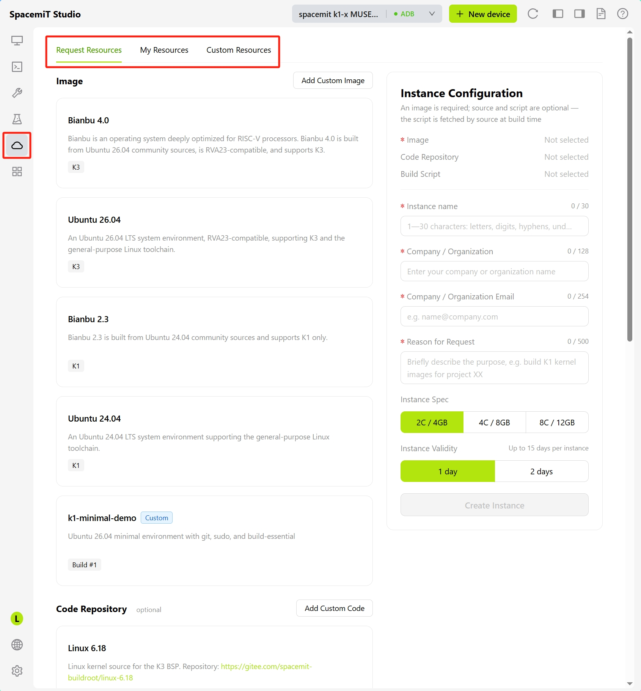

If you are new to Cloud Development, start with [Quick Start](#quick-start) and follow the complete workflow. For details about each feature, see [Request Resources](#request-resources), [My Resources](#my-resources), and [Custom Resources](#custom-resources).

## Quick Start

This section walks you through building K1 U-Boot and deploying it to a K1 development board.

> Note: This workflow pushes artifacts to a development board, so connect the target board before you begin. If you only want to build, skip step 9.

### 1. Select an Image and a Code Repository

Open the **Request Resources** tab and choose an image and code repository for your instance. For details about these options, see [Request Resources](#request-resources).

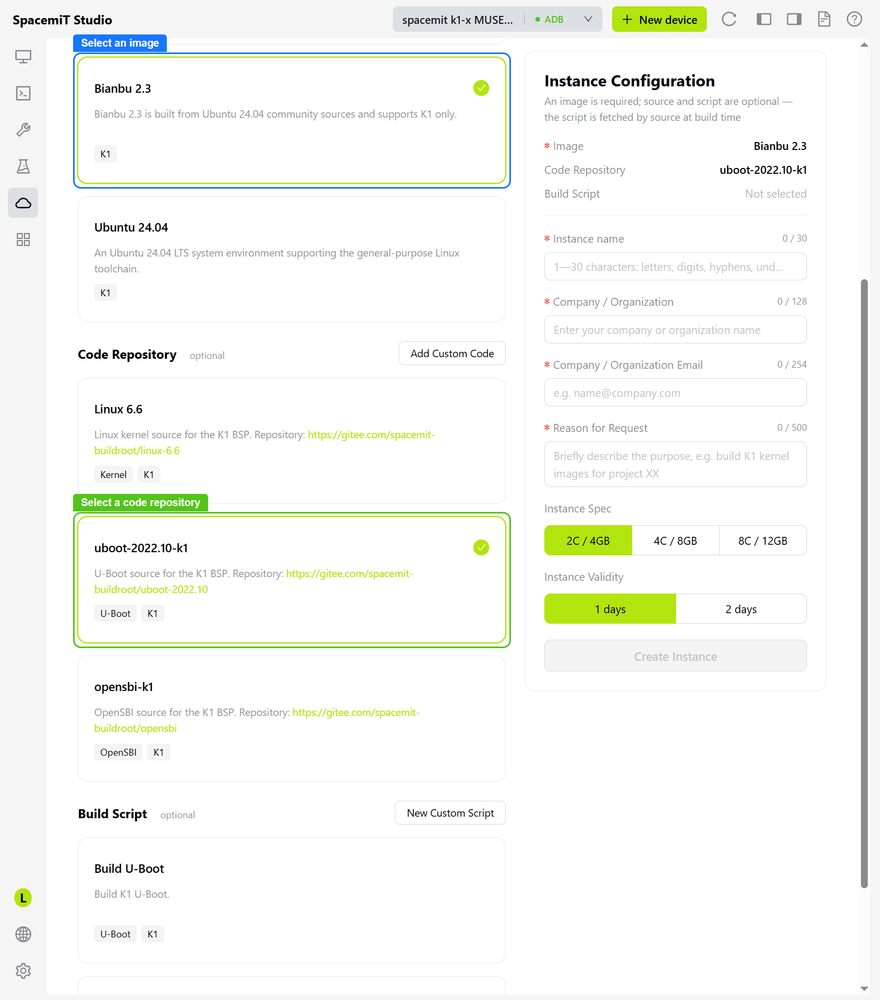

- **Image**: select **Bianbu 2.3**
- **Code Repository**: select **uboot-2022.10-k1**

The summary in the **Instance Configuration** panel on the right updates automatically to show your selected image and code repository.

> Tip: To read a card's full description, hover over it and click **View Details** in the top-right corner.

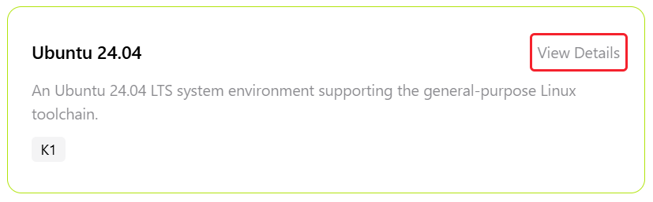

### 2. Select a Build Script

After you choose a code repository, the **Build Script** area lists the preset templates available for it:

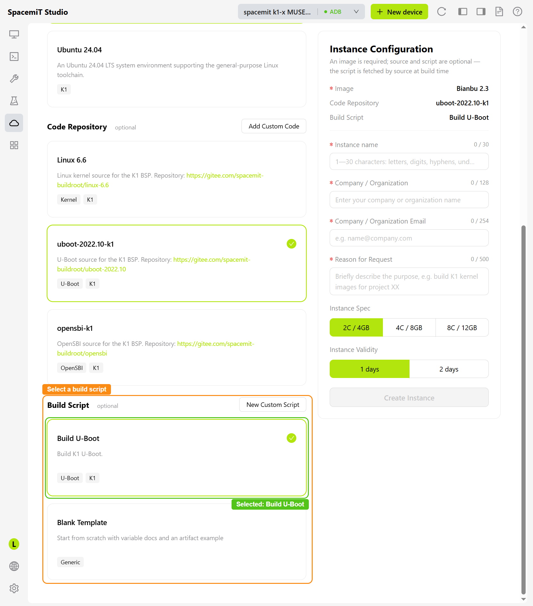

- **Build U-Boot**: builds the K1 U-Boot deb package.
- **Blank Template**: starts with an empty script.

Select **Build U-Boot**. The summary in the **Instance Configuration** panel on the right updates automatically to show the selected script.

> Note: To use your own script or repository, click **New Custom Script** or **Add Custom Code**. For details, see [My Scripts](#my-scripts) and [My Code](#my-code).

### 3. Submit the Request

In the **Instance Configuration** panel, enter the required details, choose a spec and validity period, and click **Create Instance**:

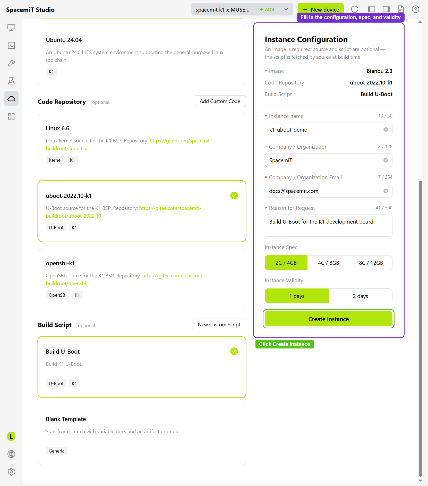

- **Instance name**: enter `k1-uboot-demo`
- **Company / Organization**, **Company / Organization Email**, **Reason for Request**: enter the details for your request
- **Instance Spec**: select `2C / 4GB`
- **Instance Validity**: select `1 day` or `2 days`

### 4. Wait for the Instance to Start

The page switches to **My Resources**, where your new instance initially shows **Starting**. Startup usually takes 30–60 seconds. When the instance is ready, its card shows **Running**:

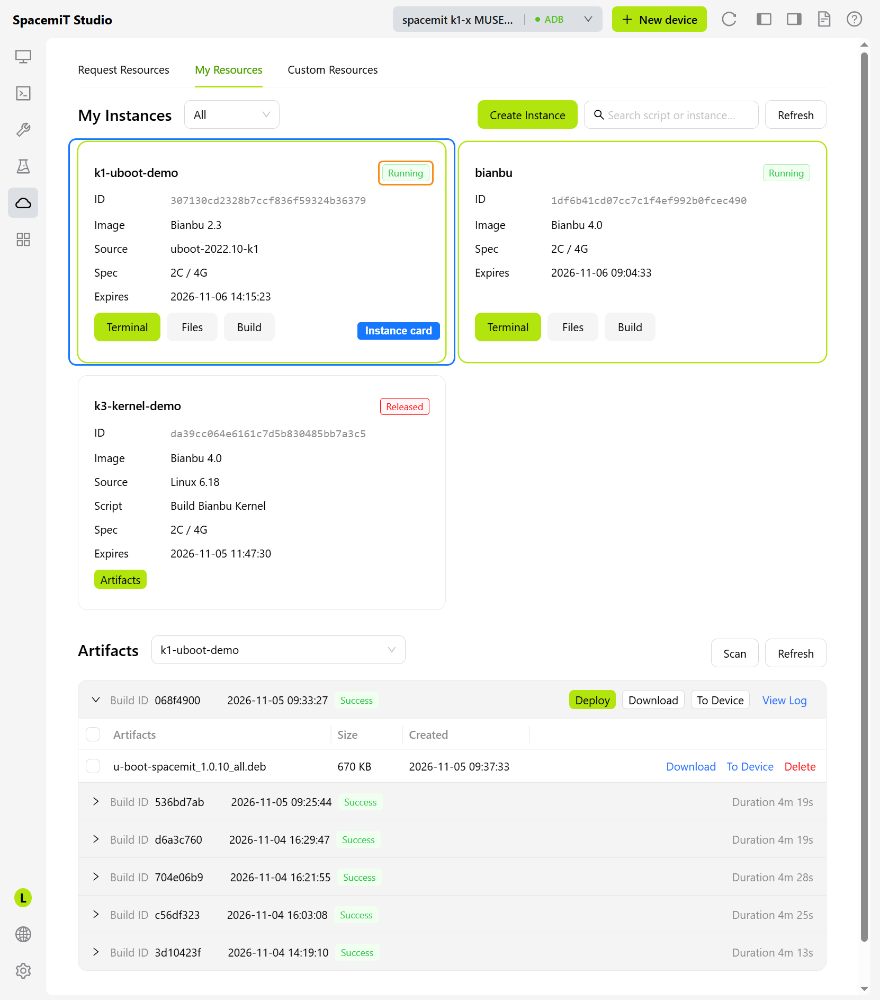

The card shows the image, source, spec, and expiry time. To open the workspace, click the card or its **Terminal** or **Files** button.

### 5. Open the Workspace

The workspace has three main areas. For the complete feature list, see [Workspace](#workspace).

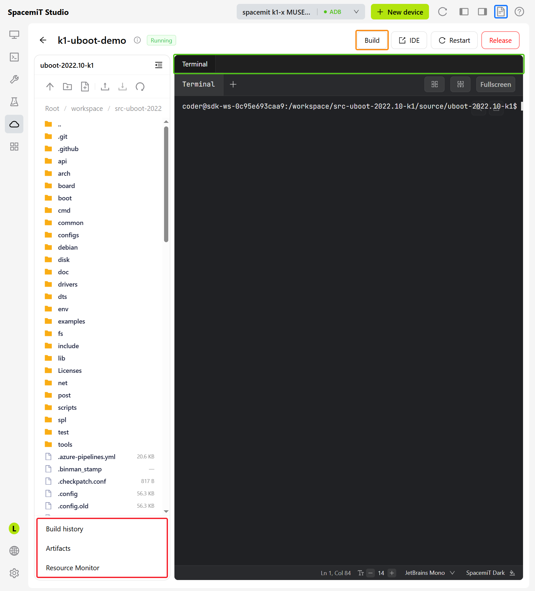

- **File manager**: the left panel shows your source tree. You can browse, upload, and download files in the workspace.
- **Terminal**: the right panel is a built-in terminal where you can run commands.
- **Build**: the button at the top starts a build, as described in the next step.

### 6. Start a Build

Click **Build** at the top of the workspace to open the **Build** dialog:

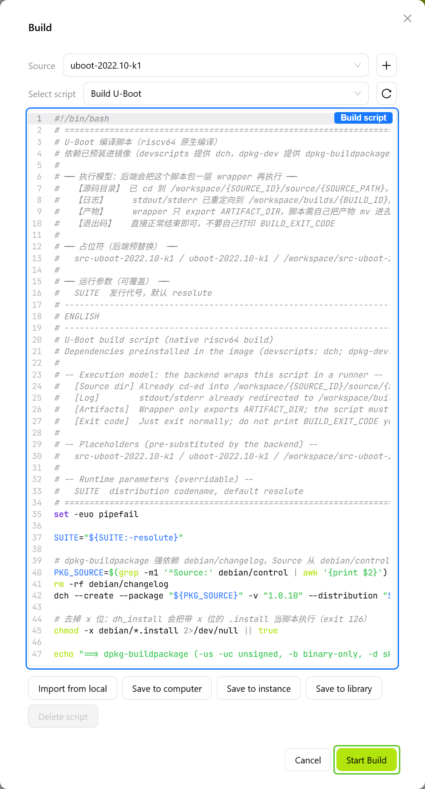

- **Source**: the code repository bound to this instance (`uboot-2022.10-k1`).
- **Select script**: the script selected when you requested the instance (**Build U-Boot**).
- **Script editor**: shows the complete build script, which you can edit before starting the build.

When everything looks correct, click **Start Build**.

> Tip: To reuse this script later, click **Save to library** in the dialog. The script is saved to [My Scripts](#my-scripts).

### 7. Check the Build Progress

Once the build starts, a **Build Log** tab opens on the right and streams the output in real time:

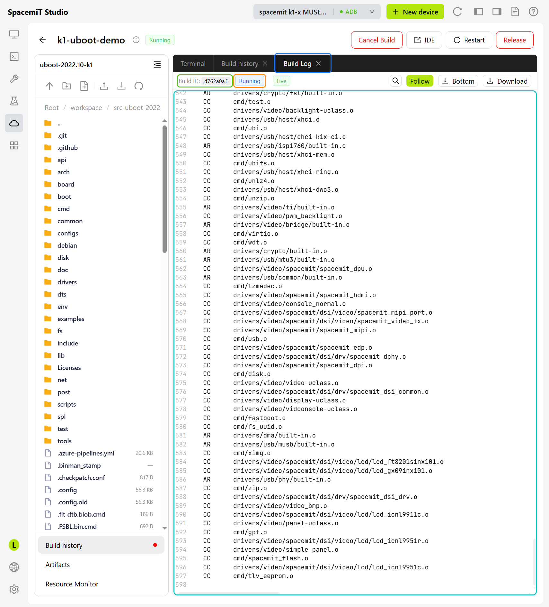

- **Build Log**: the tab that shows the current build log.
- **Build ID and status**: the build's unique ID and current status, which moves from **Pending** to **Running** and then to **Success** or a failure state. The panel also shows **Duration** and **Exit Code** when available.
- **Log output**: the build output, shown line by line while the **Live** tag is displayed. Use the toolbar to search, **Follow** new output, jump to the **Bottom**, or **Download** the log.

A U-Boot build usually takes 3–5 minutes, depending on the instance's specifications.

When the build finishes, click **Build history** in the lower-left corner of the workspace to view all builds for this instance:

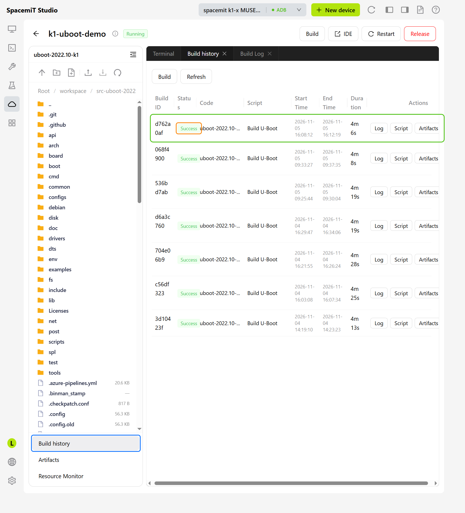

Each row shows the **Build ID**, **Status**, **Code**, **Script**, **Start Time**, **End Time**, and **Duration**, with **Log**, **Script**, and **Artifacts** buttons on the right.

### 8. Get the Build Artifacts

When the build finishes, return to **My Resources** and scroll down to the **Artifacts** area. Build records are grouped by instance:

1. In the instance dropdown, select the instance you just built on, such as `k1-uboot-demo`.
2. Click **Scan**. The platform reads the build output from the instance workspace and displays the scan result.
3. Click a build record to expand it and view the files produced by that build.

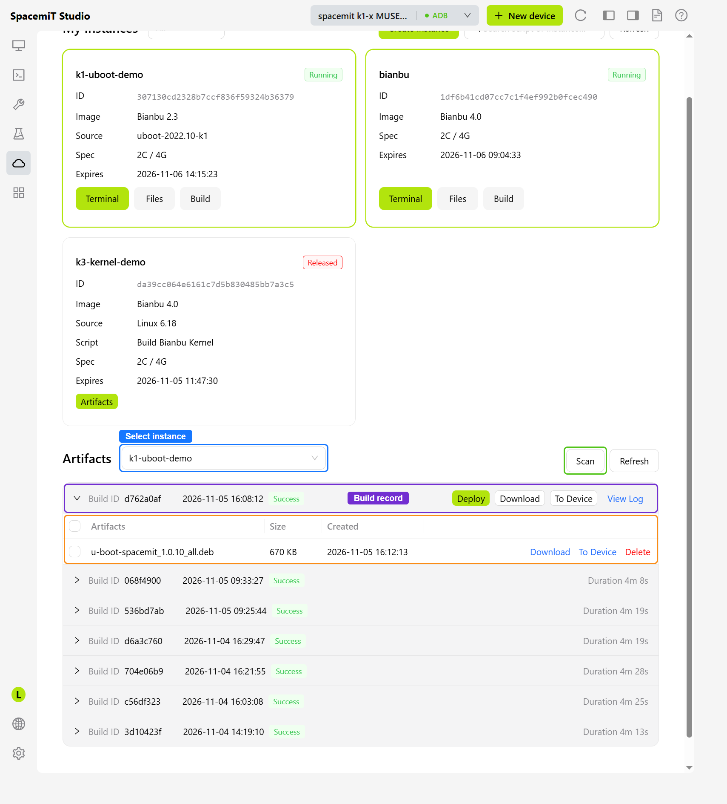

- **Build record**: a collapsible row. The left side shows the build ID, start time, and status. The right side provides **Deploy**, **Download**, **To Device**, and **View Log**.
- **Artifacts**: the expanded list of files, such as `u-boot-spacemit_1.0.10_all.deb`, with their sizes and creation times. Each file also has its own download buttons.

If a record shows no artifacts, click **Refresh** next to **Scan** to load the artifacts again.

At this point, the artifacts are still in the cloud instance's workspace. The next step explains how to transfer them to your development board.

### 9. Download and Deploy the Artifacts

You can transfer artifacts from the cloud instance to a connected development board in two ways:

- **To Device**: copies the files to a directory on the board without installing them. Use this when you want to inspect the files first or install them later.
- **Deploy**: copies the files to the board and runs the install command immediately. The changes take effect after the board reboots.

Both buttons are on the right side of the build record row. The board must be connected and running before you use either one.

#### To Device

Click **To Device** to open the **Download to device** dialog:

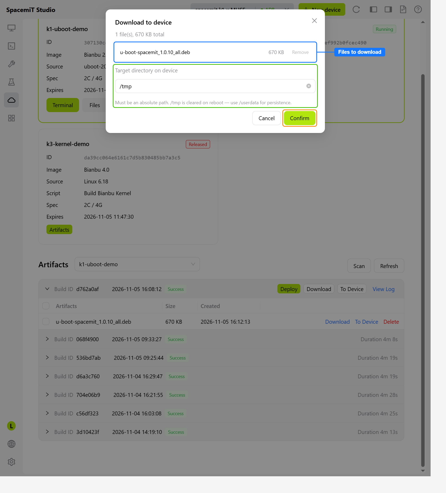

- **Files to download**: the files to copy, with their sizes.
- **Target directory on device**: the destination directory on the board. `/tmp` is cleared on reboot, so use `/userdata` for anything you want to keep.

Click **Confirm**. When the transfer finishes, a message at the top of the page confirms it, such as **Downloaded to /userdata**:

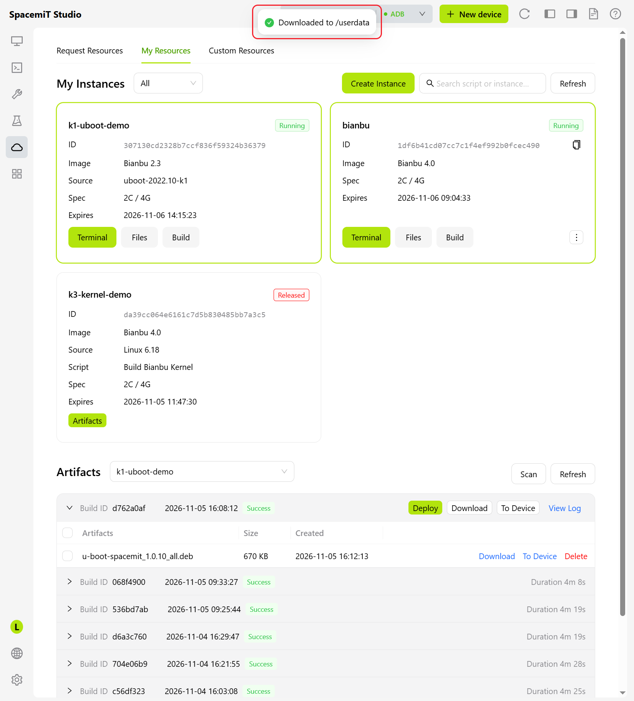

Open the board's file manager and verify that `u-boot-spacemit_1.0.10_all.deb` is now in `/userdata`.

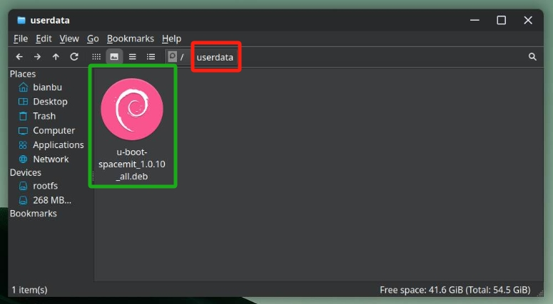

#### Deploy

**To Device** only copies files. To install the artifacts so they take effect, click **Deploy** to open the **One-click deploy to device** dialog:

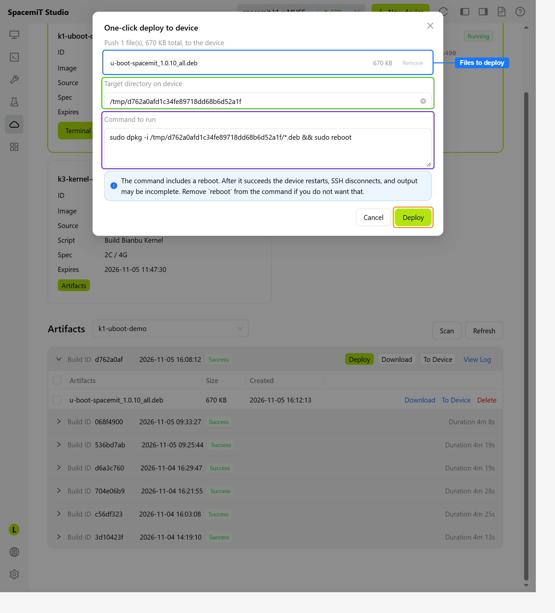

- **Files to deploy**: the files to push, with their sizes.
- **Target directory on device**: a path the platform generates from the build ID, such as `/tmp/d762a0afd1c34fe89718dd68b6d52a1f`.
- **Command to run**: generated by the platform based on the artifact type. In this example, it is `sudo dpkg -i <directory>/*.deb && sudo reboot`. You can edit it before deploying.

Click **Deploy** in the dialog. The dialog shows the file-transfer and command-execution progress. When the operation finishes, it displays **Deployment completed** and the full command **Output**:

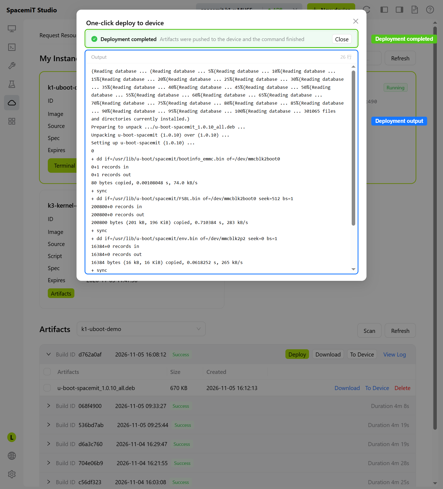

Use the log to confirm that the command succeeded. The installation steps depend on the artifact type and follow the command shown in **Command to run**.

> Note: To build for another platform or code type, such as the K3 kernel, follow the same workflow. In steps 1 and 2, select the image, code repository, and build script for that platform. See [Request Resources](#request-resources) for selection guidance.

## Request Resources

Use the **Request Resources** tab to create development instances. The left side of the page lists **Image**, **Code Repository**, and **Build Script** from top to bottom. The right side contains the **Instance Configuration** panel.

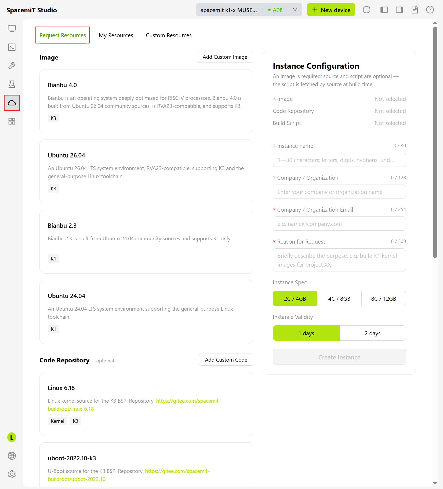

The platform maintains these options and adds new platforms and versions over time, so this guide does not list them. The page always shows the current options. Follow one rule: **the image and the code repository must target the same platform**. Pair a K1 image with K1 code, and a K3 image with K3 code. To read a card's full description, hover over it and click **View Details**.

### Select an Image

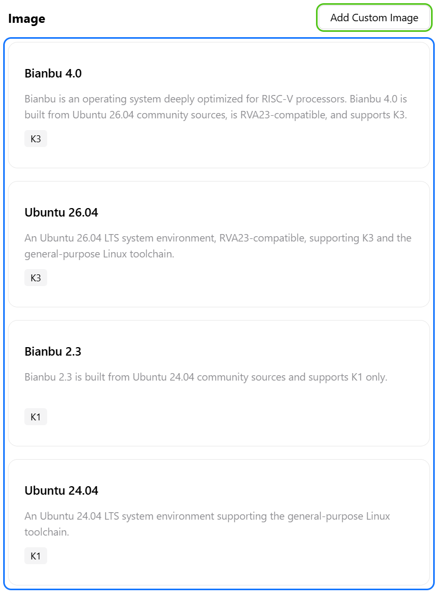

An **Image** is required and determines the operating system used by your instance. The platform provides two image families, each available for K1 and K3:

- **Bianbu**: a distribution tuned for RISC-V processors.
- **Ubuntu**: a standard Ubuntu environment with a general-purpose Linux toolchain, suitable for testing upstream code.

Click a card to select it. If none of the images meets your needs, click **Add Custom Image** in the top-right corner to use your own. See [My Images](#my-images).

### Select a Code Repository

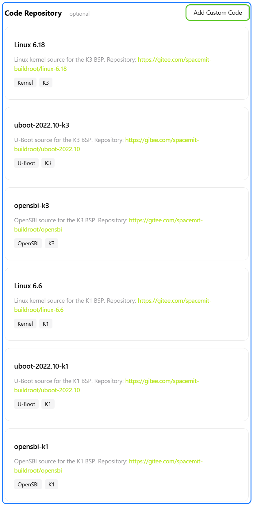

A **Code Repository** is optional. The platform provides BSP source code for each component (Kernel, U-Boot, and OpenSBI) on each platform (K1 and K3). Card tags show the code type and platform, and the description includes the repository URL.

Select a card to use a preset repository. To use your own, click **Add Custom Code** in the upper-right corner. For details, see [My Code](#my-code).

### Select a Build Script

A **Build Script** is optional, but you must select a code repository first. Until you do, this area displays "Pick a source first, then choose its build script". It then lists preset templates for that type of code, plus a **Blank Template** if you want to start from scratch.

Click a card to select it. The platform fetches the latest version of the script for the selected source each time you build.

To write your own script, click **New Custom Script**. See [My Scripts](#my-scripts).

### Fill in the Instance Configuration

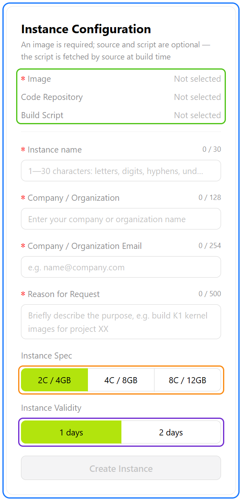

The top of the **Instance Configuration** panel summarizes your selected image, code repository, and build script and updates as you make changes. The following fields are required: **Instance name**, **Company / Organization**, **Company / Organization Email**, and **Reason for Request**. Instance names may contain only letters, digits, hyphens, and underscores.

### Select the Spec and Validity

Choose an **Instance Spec** that matches your build workload and an **Instance Validity** that covers the time you need the instance.

When you are done, click **Create Instance** at the bottom of the panel. You are taken to [My Resources](#my-resources), where the new instance appears with the status **Starting**.

## My Resources

Use the **My Resources** tab to manage instances, open a workspace for development, and retrieve build artifacts. The upper part contains **My Instances**, and the lower part contains the **Artifacts** area.

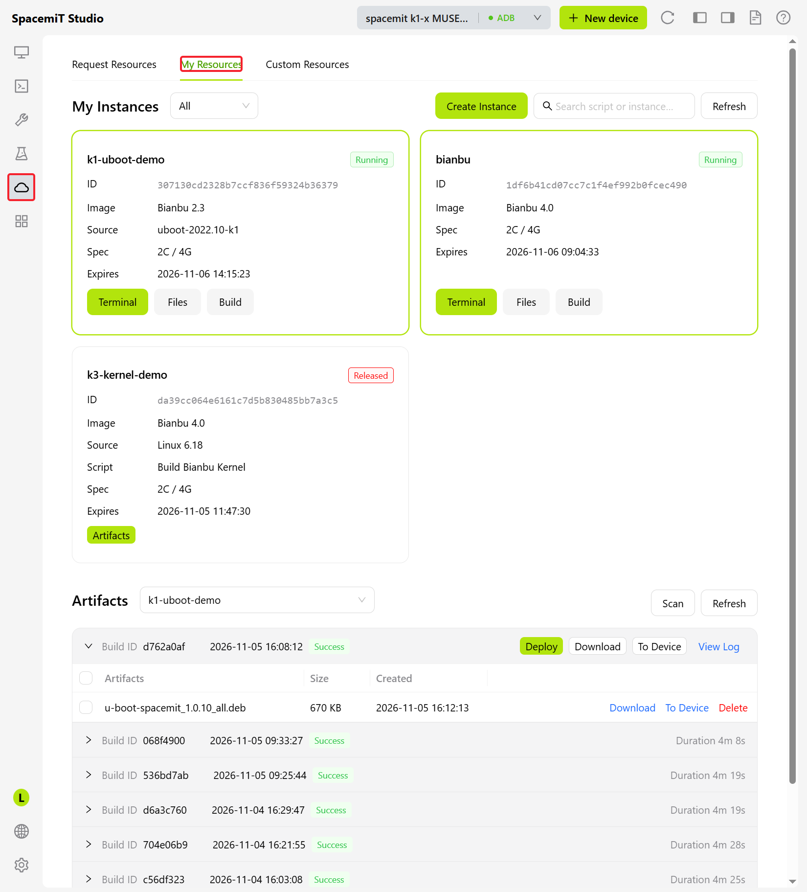

### Instance List

The toolbar at the top of the list provides these controls:

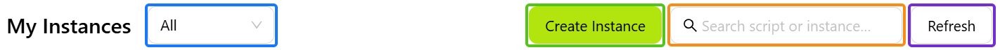

- **Status filter**: shows **All** by default. You can filter by Starting, Running, Failed to start, Stopped, or Released.
- **Create Instance**: opens the **Request Resources** tab, where you can create a new instance. See [Request Resources](#request-resources).
- **Search**: find an instance by script or instance ID.
- **Refresh**: refresh the instance list and statuses.

Each instance card shows the name, status, ID, image, source, script (if any), spec, and expiry time. The buttons at the bottom of the card depend on the instance status:

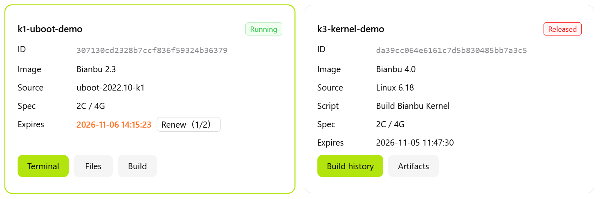

- **Running**: provides **Terminal**, **Files**, and **Build** for opening the terminal, browsing files, and starting a build.
- **Released**: the instance's resources have been reclaimed. The card provides **Build history** and **Artifacts** for viewing previous build information. Hover over the card to reveal **Delete** in the lower-right corner and remove the card.

When you hover over a running card, a copy button appears next to the ID, and a **More** button appears in the lower-right corner for renaming, restarting, or releasing the instance early:

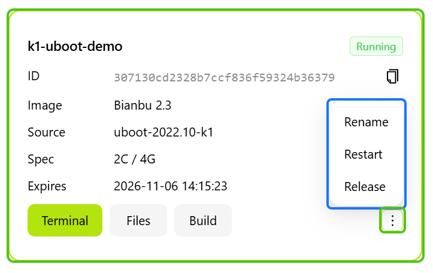

> Note: When an instance expires or is released, its workspace is reclaimed. You can still view its build records, but you can no longer scan, download, or deploy artifacts from it. Download any artifacts you want to keep before releasing the instance.

### Workspace

Click an instance card or its **Terminal** or **Files** button to open the workspace:

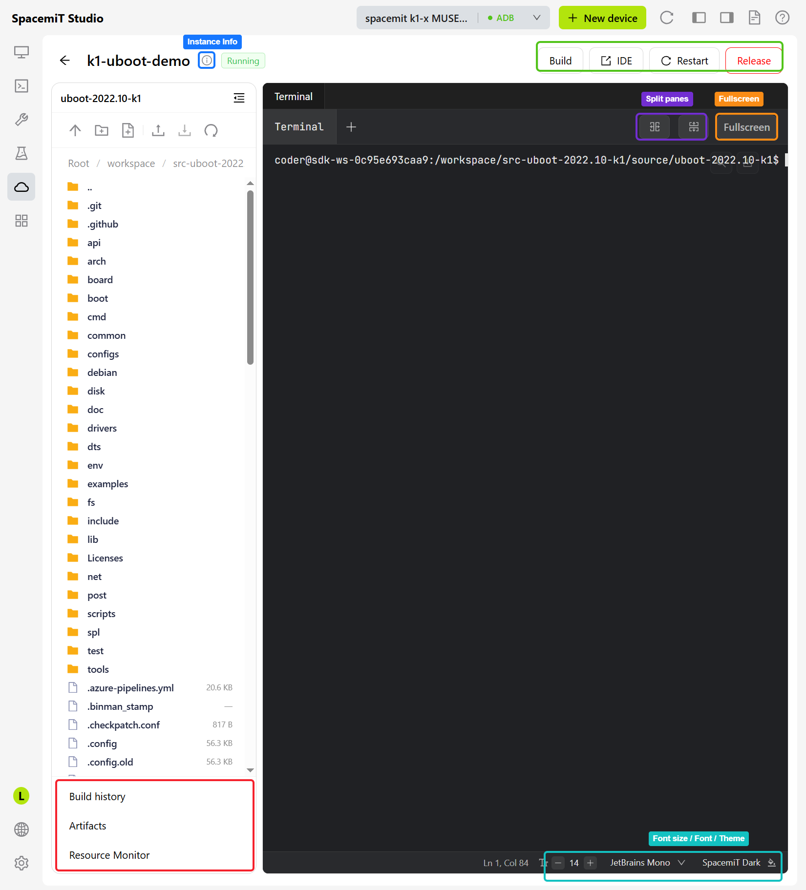

- **Instance Info**: click the icon next to the instance name to view the instance ID, image, source, spec, and expiry time. It also shows the resource limit and PVC size. PVC size is fixed when you first request the instance, so changing the spec later does not expand it.
- **Top actions**: **Build** opens the build dialog (see [step 6](#6-start-a-build)); **IDE** opens the web IDE; **Restart** and **Release** perform the same actions as the corresponding items in the card's **More** menu.
- **File manager**: the left panel shows the workspace directory tree. Its toolbar lets you go up one level, create a folder or file, upload, download, and refresh.
- **Terminal**: click **+** to open a new terminal tab. The terminal supports split panes and **Fullscreen**. Its bottom status bar lets you adjust the font size, **Font**, and **Color theme**.
- **Lower-left navigation**: click **Build history**, **Artifacts**, or **Resource Monitor** to open the corresponding view in a new tab on the right.

#### Change the Source and Script

Hover over the code name at the top of the file panel to reveal the **Change** button. Click it to open the **Pick Source & Script** dialog, where you can bind a different code repository and build script to the instance:

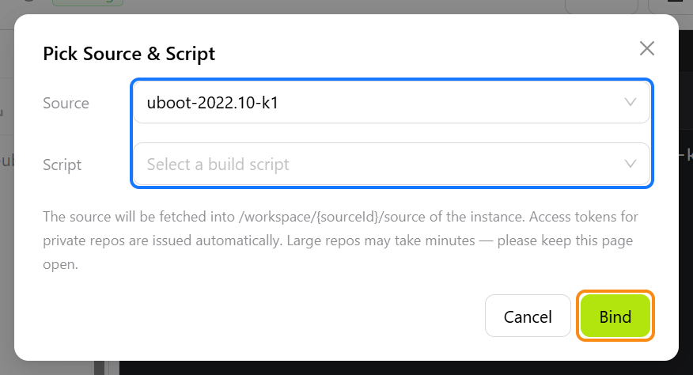

#### Resource Monitor

**Resource Monitor** shows the instance's CPU, memory, and disk usage in real time. Use the dropdown in the top-right corner to select the time range:

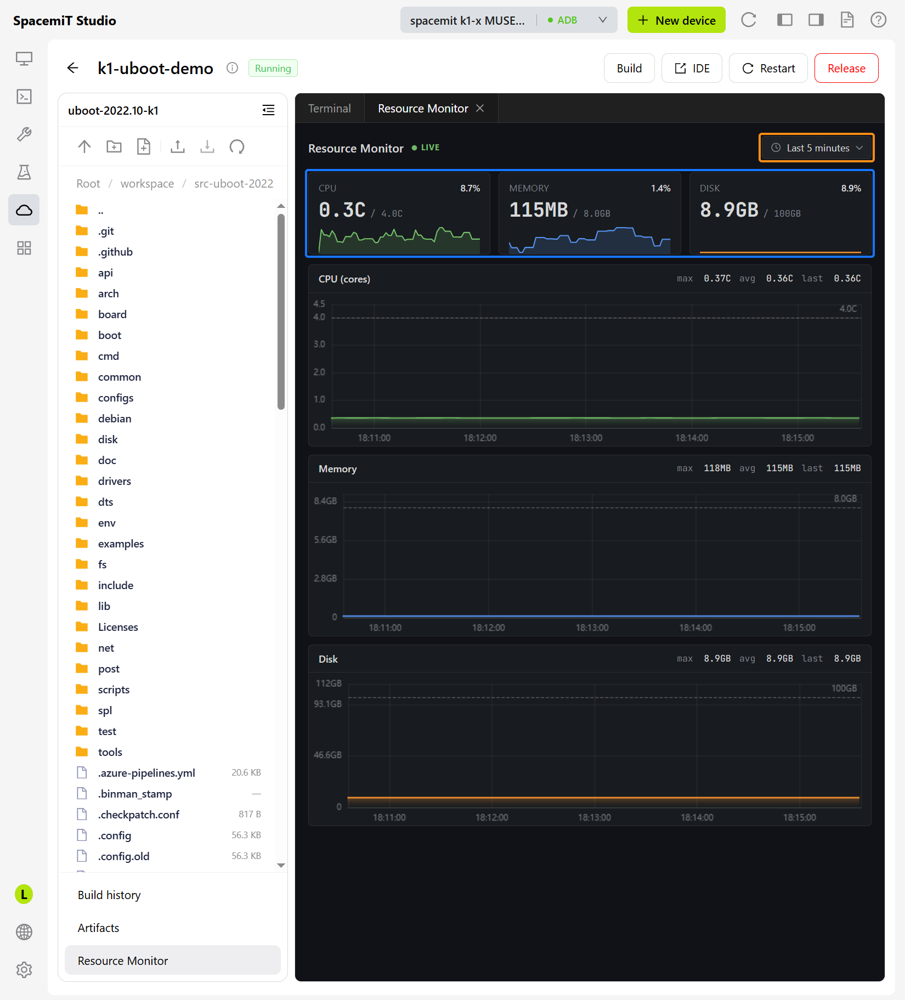

The three cards at the top show current usage and the corresponding limits. The charts below show trends over the selected range, including the maximum (max), average (avg), and latest (last) values. If a build slows down, check whether it has reached the CPU or memory limit before requesting a larger instance (see [Select the Spec and Validity](#select-the-spec-and-validity)).

### Artifacts

The **Artifacts** area at the bottom of the page groups build records by instance. For the workflow, see [Quick Start step 8](#8-get-the-build-artifacts).

Each record provides these actions. For the complete **Deploy** and **To Device** workflows, see [step 9](#9-download-and-deploy-the-artifacts):

- **Deploy**: push to the development board and run the install command.
- **To Device**: only transfer to a directory on the board.
- **Download**: download to your computer.
- **View Log**: view the full log of this build.

## Custom Resources

The **Custom Resources** tab has three sub-tabs, **My Images**, **My Code**, and **My Scripts**, where you can save development resources for reuse. Everything you create here is private to your account and can be selected directly when you [request resources](#request-resources).

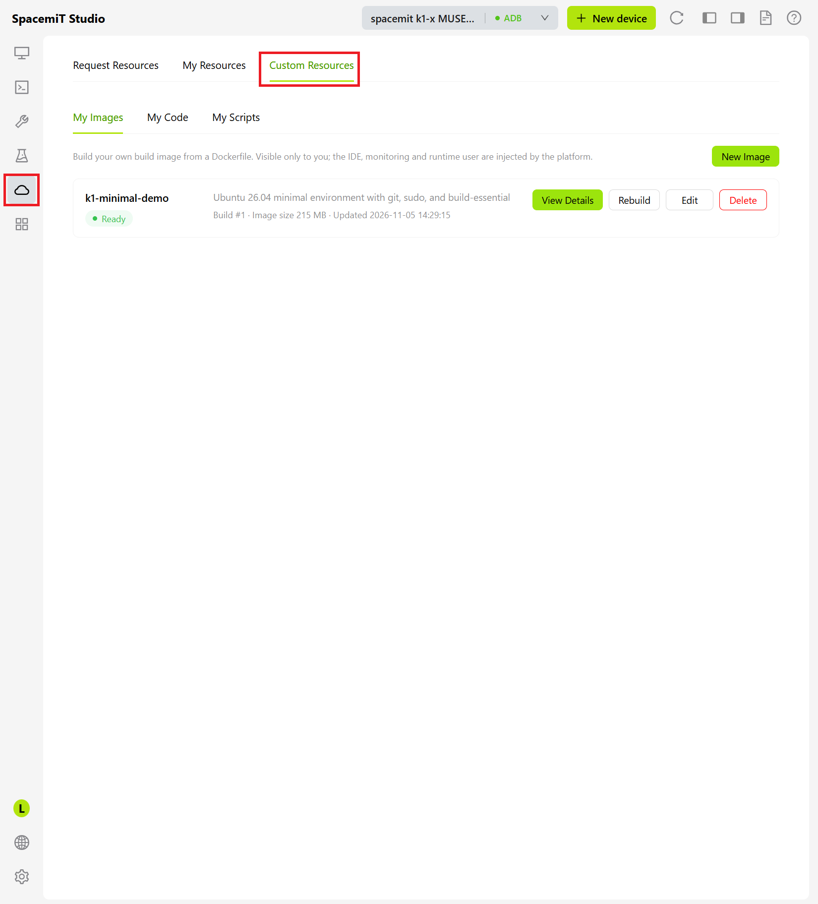

The three resource types are independent but can be combined: the image defines the build environment, the repository provides the source code, and the script defines the build steps.

### My Images

Build your own image from a Dockerfile. The platform injects the IDE, monitoring components, and runtime user during the build, so you do not need to install them yourself.

The base image must support `riscv64`, use glibc (Alpine is not supported), and include `bash`, `coreutils`, GNU `grep`, `procps`, and `findutils`. Builds cannot use `COPY` to include local files; the platform overrides `ENTRYPOINT`, `CMD`, `USER`, and `EXPOSE`. See **Before you start** in the creation dialog for the current requirements and limits.

Click **New Image** to open the creation dialog:

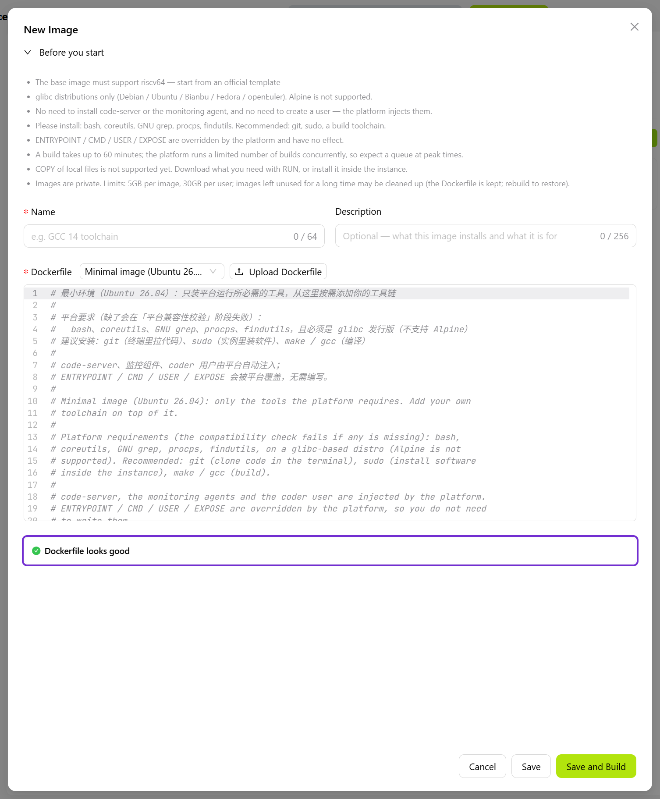

- **Before you start**: lists the base image requirements, expected build time, and size limits. Review it before creating an image.
- **Name** and **Description**: **Name** is required; **Description** helps you identify the image later.
- **Dockerfile**: choose a starting point from the preset template dropdown, or click **Upload Dockerfile** to import an existing file. The templates include a minimal image and kernel build images for each platform.

The platform validates the Dockerfile as you edit it and shows the result below the editor. When validation passes, click **Save and Build** to start the build, or click **Save** to save the image and build it later.

When the build finishes, the list shows **Ready**, along with the build number, image size, and update time. Use **Rebuild**, **Edit**, and **Delete** to rebuild, modify, or remove the image.

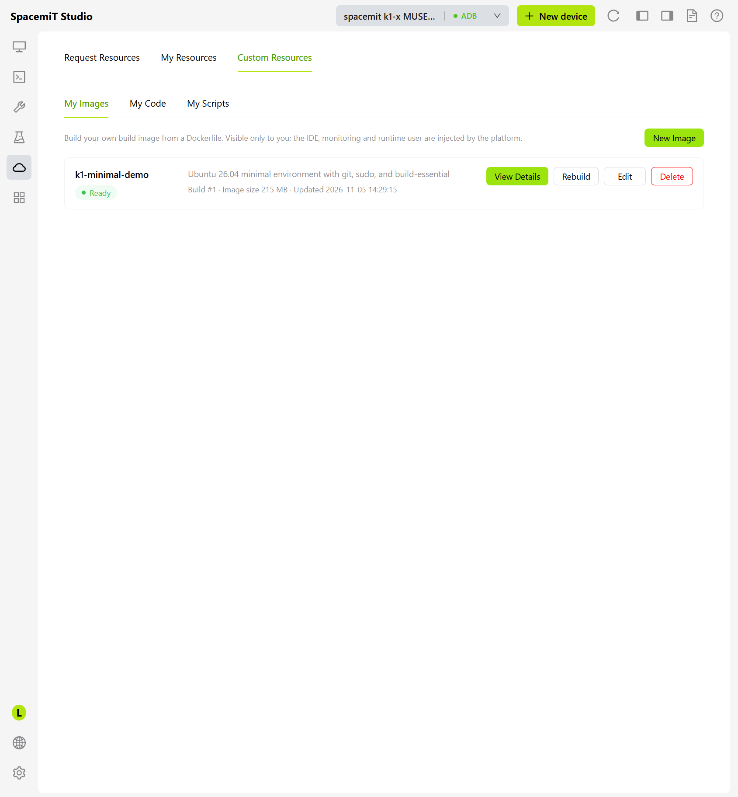

Click **View Details** to open the details page, which shows the build progress (queue, Dockerfile build, platform runtime injection, and platform compatibility check) and the build log. You can also click **Create Instance** there to create an instance from the image.

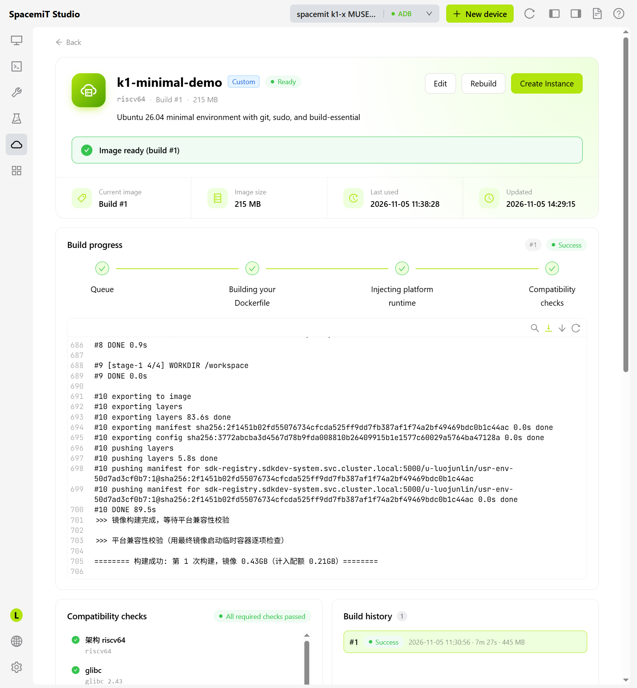

### My Code

Link your own Git repository to build it in the cloud. The platform clones the code into your workspace automatically.

Click **Add Code** to open the dialog:

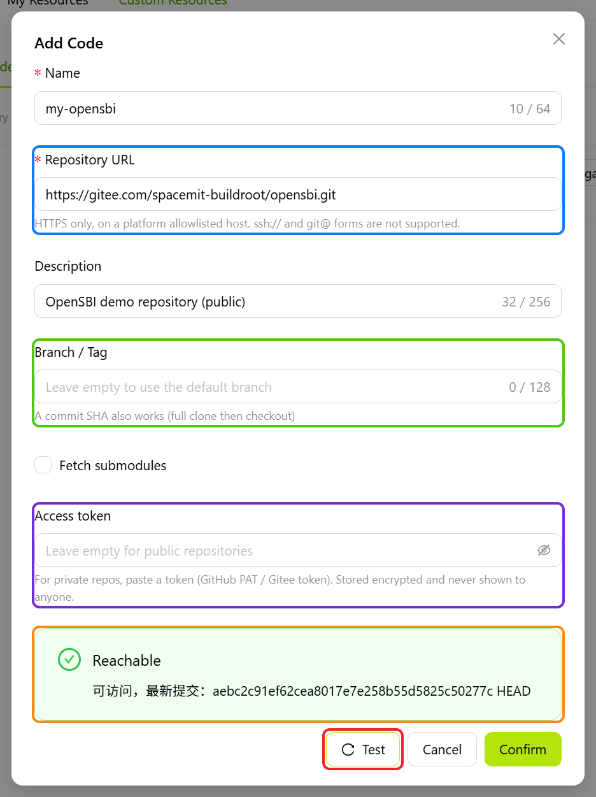

- **Name**: required; identifies this code when you request an instance.
- **Repository URL**: the Git repository URL to link. Currently, only HTTPS URLs on allowlisted hosts (Gitee / GitHub) are supported; `ssh://` and `git@` addresses are not supported.
- **Description**: optional; use it to identify the code later.
- **Branch / Tag**: specify a branch, tag, or commit ID, or leave blank to use the repository's default branch. A commit ID requires a full clone before checkout.
- **Fetch submodules**: select it if the repository contains submodules.
- **Access token**: required only for private repositories.

After entering the repository URL, click **Test**. The platform checks connectivity and displays the latest commit. When the test passes, click **Confirm** to save the code resource.

Each code card shows the **Reachable** status, repository URL, and code size. Code that has not been cloned yet shows **Not cloned yet**. The card provides **View Details**, **Test again**, **Edit**, and **Delete**.

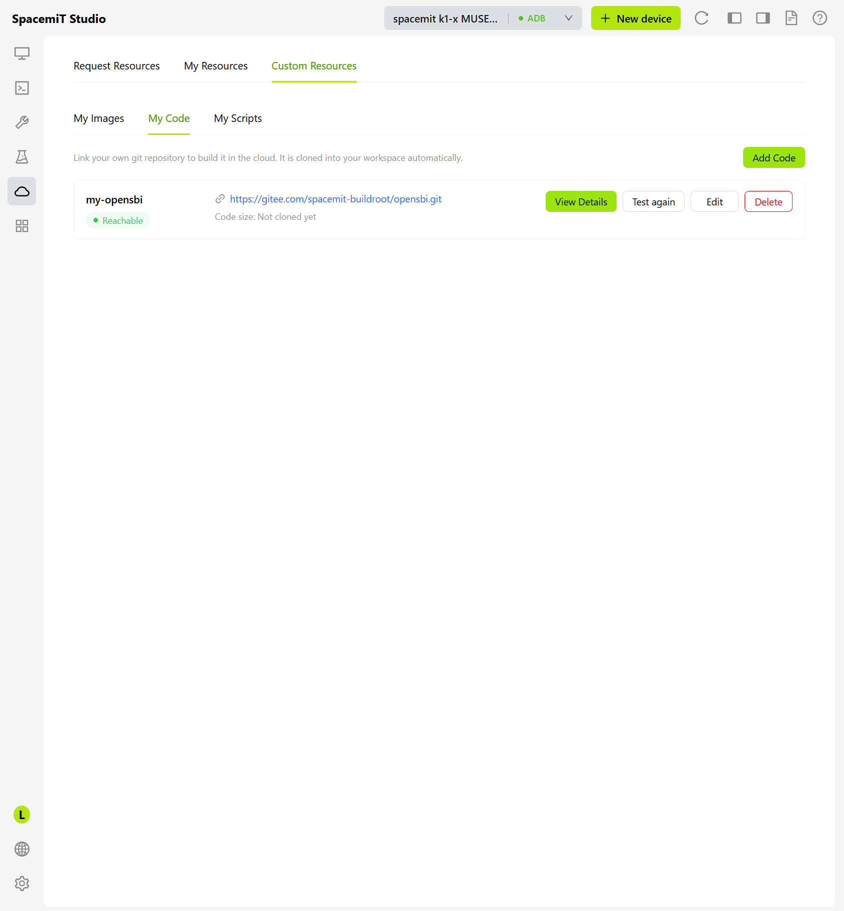

> Note: Code must pass the connectivity test before it can be used to request an instance.

### My Scripts

Save your build steps as scripts and reuse them across workspaces.

Click **Writing guide** next to the description to view the script-writing rules:

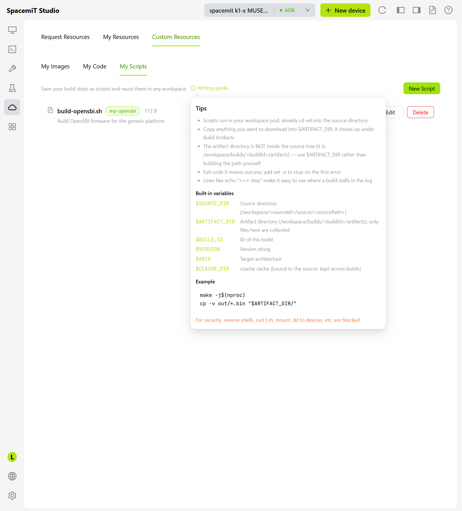

The most important rule is to copy your artifacts into `$ARTIFACT_DIR`; otherwise, they will not appear under **Artifacts** after the build.

Click **New Script** to open the editor:

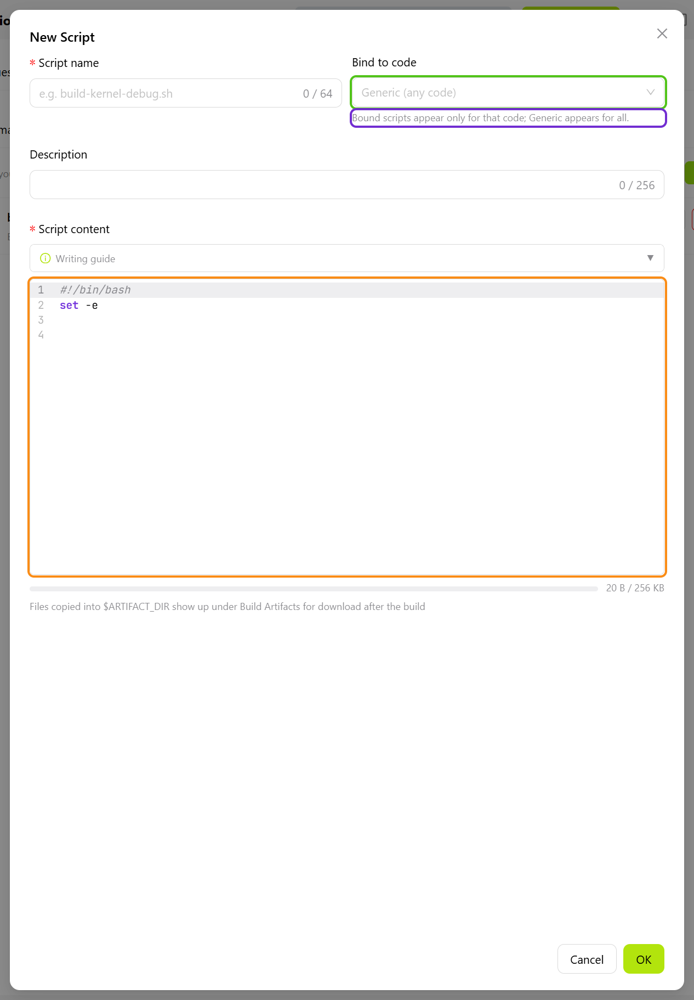

- **Script name**: required, for example `build-opensbi.sh`.
- **Bind to code**: select the code repository the script applies to, or select **Generic (any code)**.
- **Description**: optional; use it to identify the script later.
- **Script content**: required. The editor supports syntax highlighting. Expand **Writing guide** above the editor to review the writing rules.
- Below the editor, you can see the script size and a reminder of where to place artifacts.

When you are done, click **OK** to save. The saved script card shows the script name, bound code, size, and description, and provides **View Details**, **Edit**, and **Delete**.

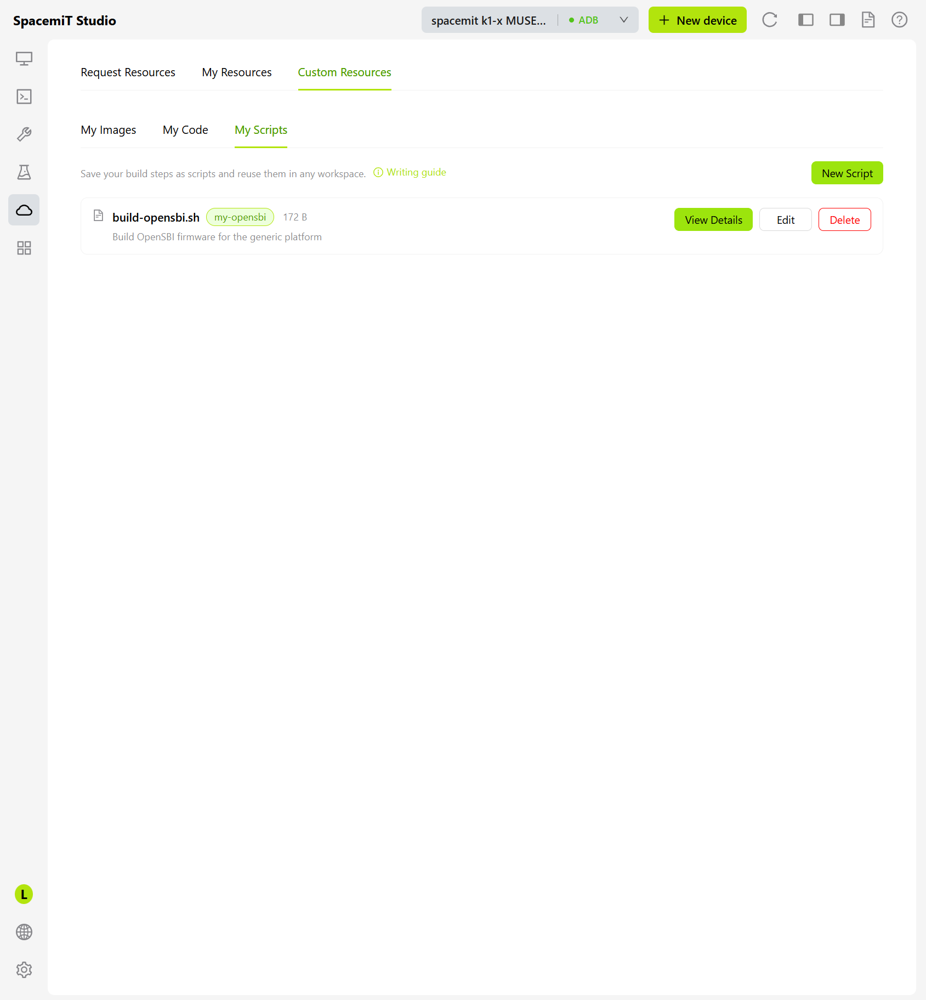
