---
sidebar_position: 6
---

# 云上开发

## 概述

云上开发把编译环境搬到云端。开发者无需在本地搭建 RISC-V 交叉编译环境，即可在云端完成代码编译、打包与产物分发。

一条完整的开发链路如下：

1. **申请资源**：选择镜像与代码，填写配置，创建云端开发实例。
2. **我的资源**：在实例中打开终端或文件管理进行开发，发起编译并获取产物。
3. **自定义资源**：把自建的镜像、代码仓库和构建脚本沉淀下来，供后续复用。

页面顶部包含**申请资源**、**我的资源**、**自定义资源**三个标签页，分别对应上述三个环节。

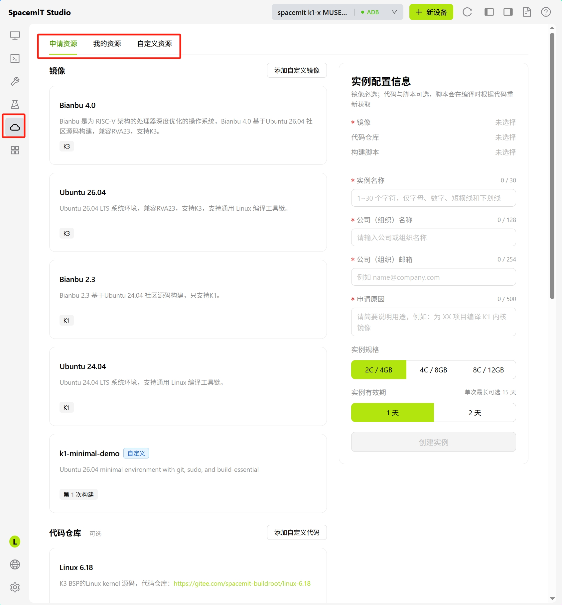

初次使用建议先阅读[快速上手](#快速上手)，跟着步骤走一遍完整流程；各功能的详细说明见[申请资源](#申请资源)、[我的资源](#我的资源)和[自定义资源](#自定义资源)。

## 快速上手

以编译 K1 U-Boot 并部署到 K1 开发板为例，演示完整的云上开发流程。

> 注：本节涉及将产物推送到开发板，请先连接目标开发板。若只想完成编译，可跳过第 9 步。

### 1. 选择镜像与代码仓库

在**申请资源**标签页，选择镜像和代码仓库（各选项说明见[申请资源](#申请资源)）：

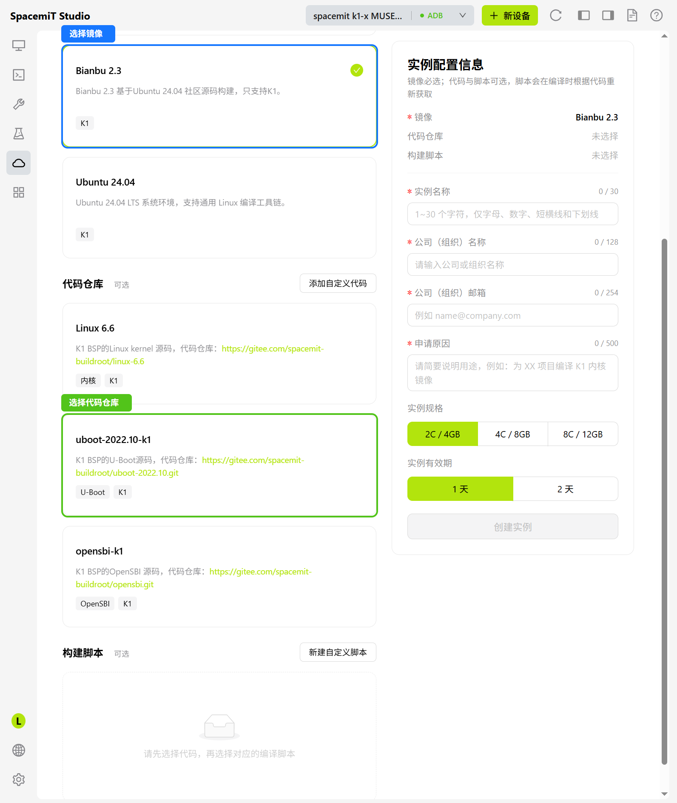

- **镜像**：选择 **Bianbu 2.3**
- **代码仓库**：选择 **uboot-2022.10-k1**

右侧实例配置面板中的摘要会自动更新，显示已选的镜像和代码仓库。

> 提示：鼠标悬停在镜像或代码卡片上，点击右上角的**查看详情**可展开完整描述。

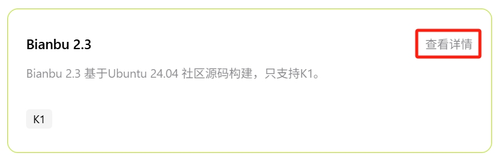

### 2. 选择构建脚本

选择代码仓库后，**构建脚本**区域会显示平台预置的模板：

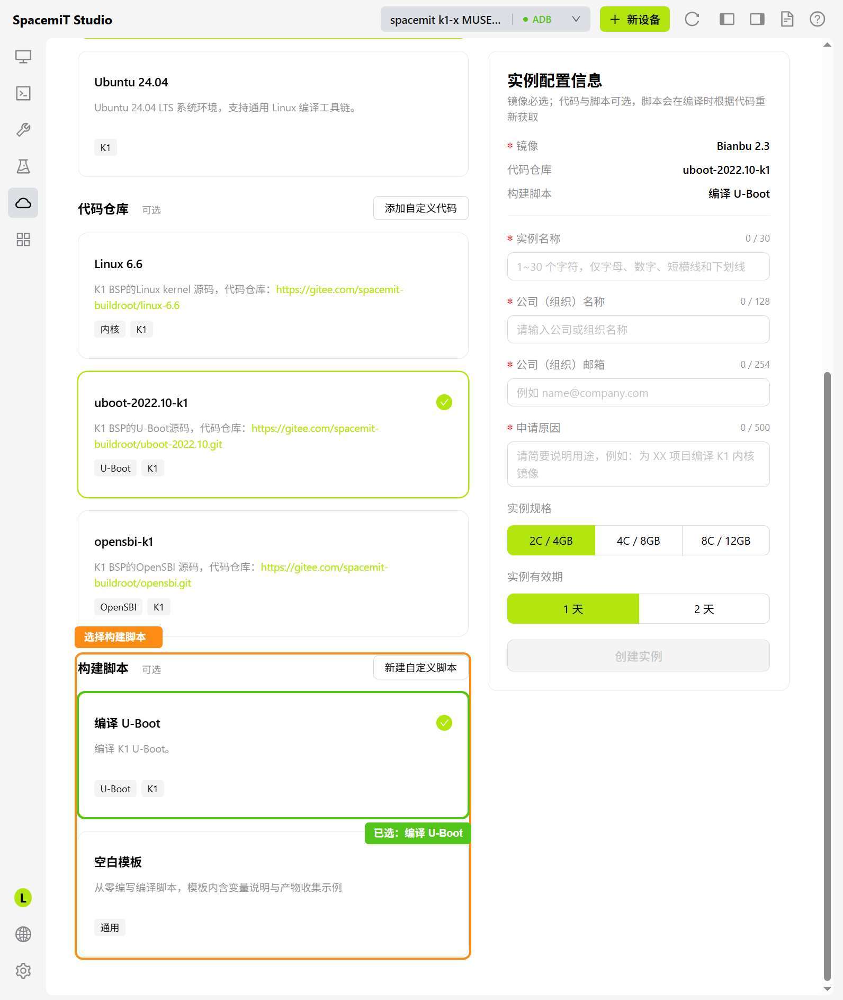

- **编译 U-Boot**：编译 K1 U-Boot deb 包
- **空白模板**：从头编写脚本

选择**编译 U-Boot**。右侧实例配置面板中的摘要会自动更新，显示所选脚本。

> 注：也可点击**新建自定义脚本**创建脚本，或点击**添加自定义代码**关联自建仓库，详见[我的脚本](#我的脚本)与[我的代码](#我的代码)。

### 3. 提交申请

填写实例配置信息，选择规格与有效期后，点击**创建实例**：

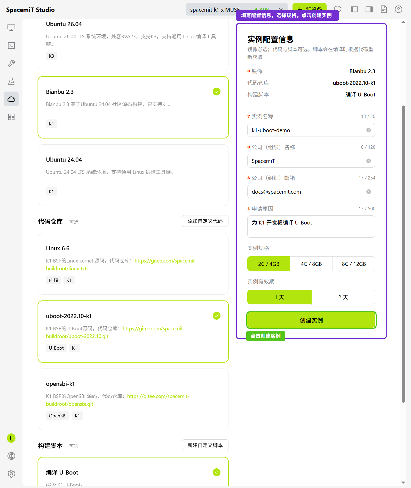

- **实例名称**：填写 `k1-uboot-demo`
- **公司（组织）名称**、**邮箱**、**申请原因**：根据实际情况填写
- **实例规格**：选择 `2C / 4GB`
- **实例有效期**：选择 1 天或 2 天

### 4. 等待实例启动

页面自动跳转至**我的资源**，新实例显示**启动中**状态，预计 30-60 秒完成：

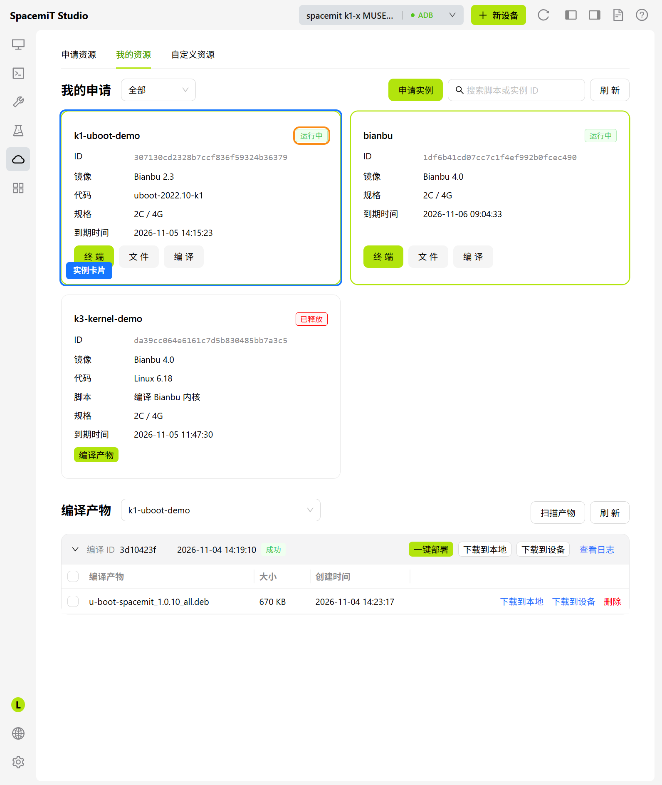

实例卡片展示镜像、代码、规格和到期时间。状态变为**运行中**后，点击卡片或卡片上的**终端**、**文件**按钮进入工作台。

### 5. 打开工作台

工作台主要包括以下部分（完整功能见[工作台](#工作台)）：

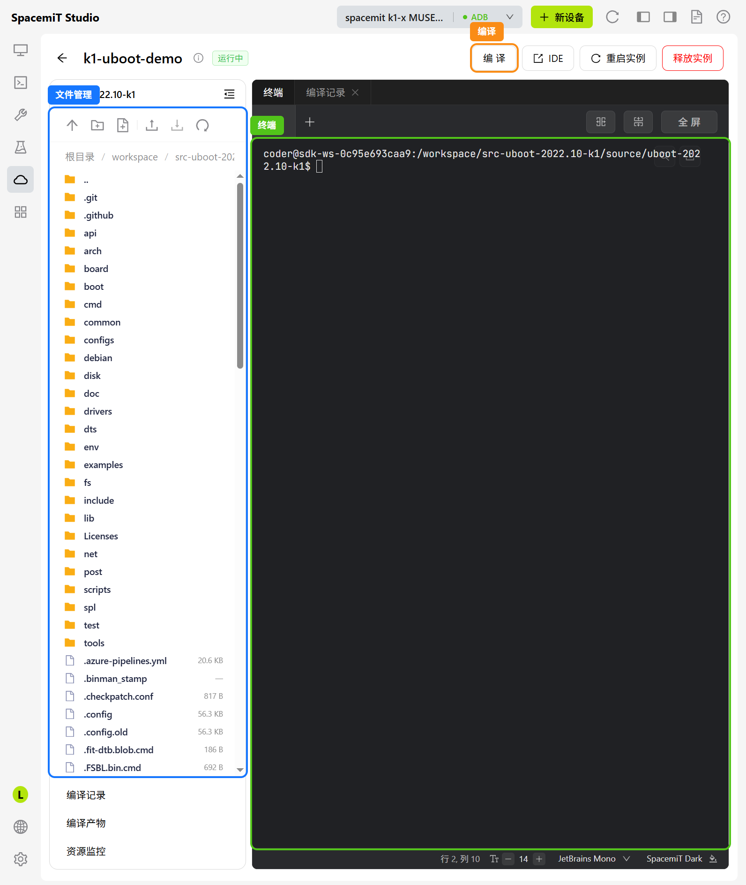

- **文件管理**：左侧面板，展示代码目录树，可浏览、上传、下载工作区文件。
- **终端**：右侧面板，内置终端，可执行命令。
- **编译**：顶部按钮，用于发起编译，见下一步。

### 6. 发起编译

点击顶部的**编译**按钮，打开编译对话框：

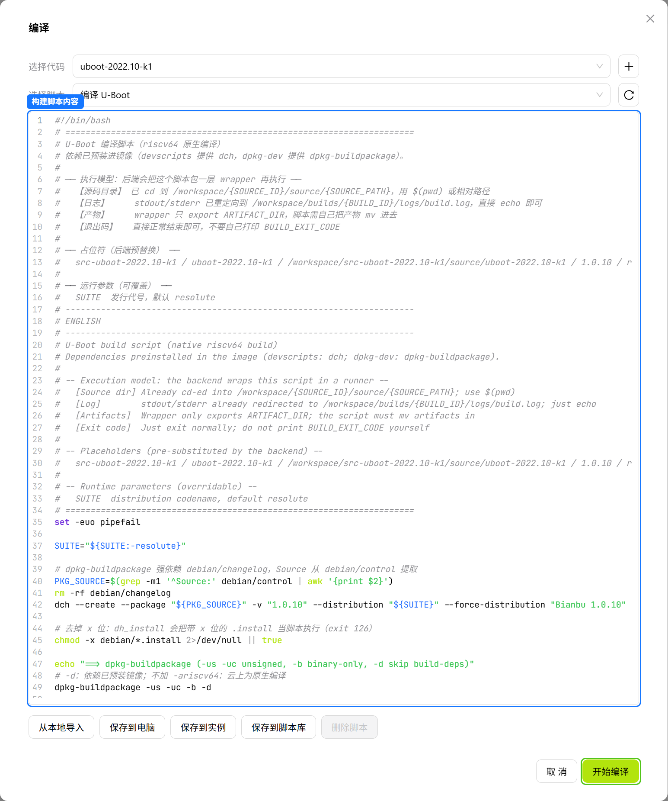

- **选择代码**：显示当前代码仓库（uboot-2022.10-k1）
- **选择脚本**：显示申请时选择的脚本（编译 U-Boot 默认脚本）
- 脚本编辑器显示完整的构建脚本内容，可直接修改

确认无误后，点击**开始编译**。

> 提示：可点击对话框中的**保存到脚本库**，把当前脚本保存到[我的脚本](#我的脚本)，供后续复用。

### 7. 查看编译进度

编译启动后，右侧弹出**编译日志**面板，实时输出编译过程：

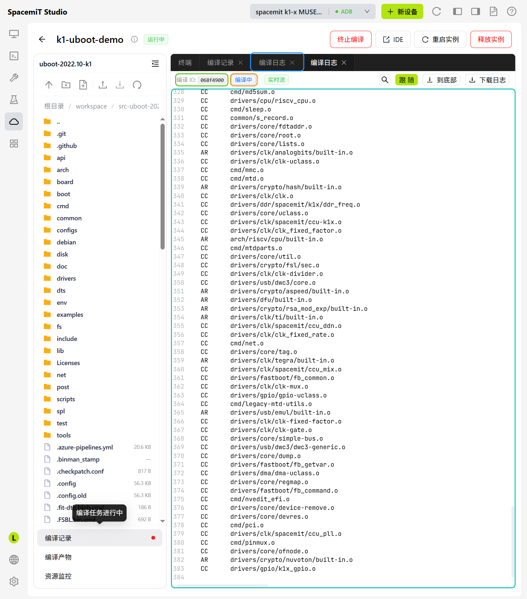

- **编译日志**：日志面板标签页。
- **编译 ID 与状态**：显示本次编译的唯一标识和状态（等待中/编译中/成功/失败），以及可用的耗时与退出码。
- **实时日志**：逐行输出编译过程，支持跟随、搜索、到底部、下载日志。

U-Boot 编译通常需要 3-5 分钟，取决于实例规格。

编译结束后，点击工作台左下角的**编译记录**可查看历史记录：

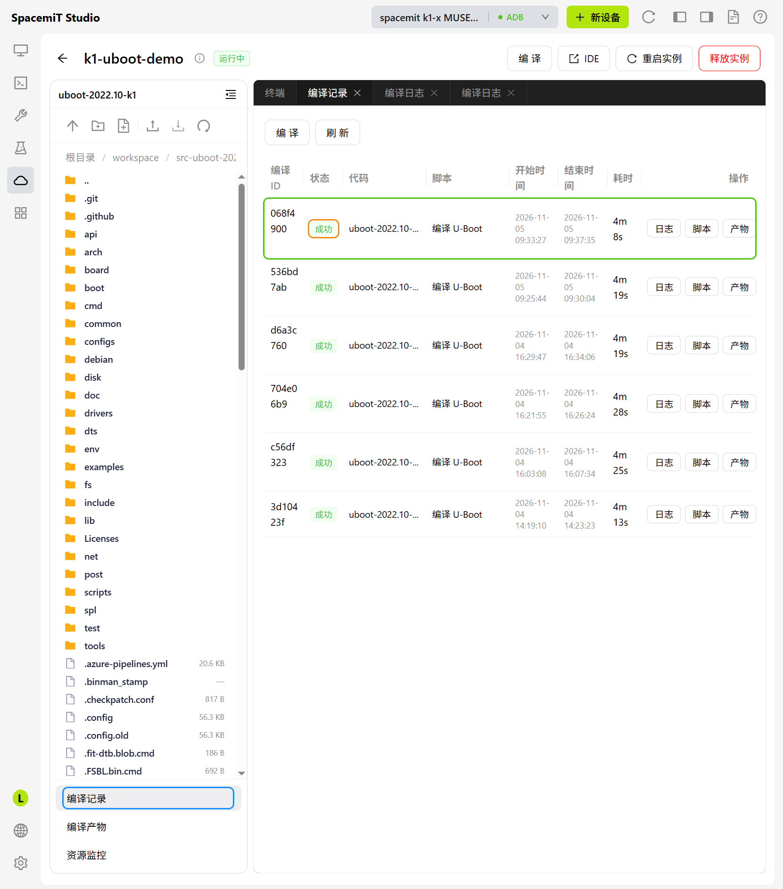

每行记录展示**编译 ID**、**状态**（成功）、**代码**、**脚本**、**开始时间**、**结束时间**、**耗时**，并提供**日志**、**脚本**、**产物**三个操作按钮。

### 8. 获取编译产物

编译完成后，返回**我的资源**页面，滚动到页面下方的**编译产物**区域。这里按实例汇总历史编译记录：

1. 在实例下拉框中选中刚完成编译的实例（如 `k1-uboot-demo`）。
2. 点击**扫描产物**，平台读取该实例工作区中的编译输出，完成后提示扫描结果。
3. 点击记录行展开，查看本次编译生成的文件。

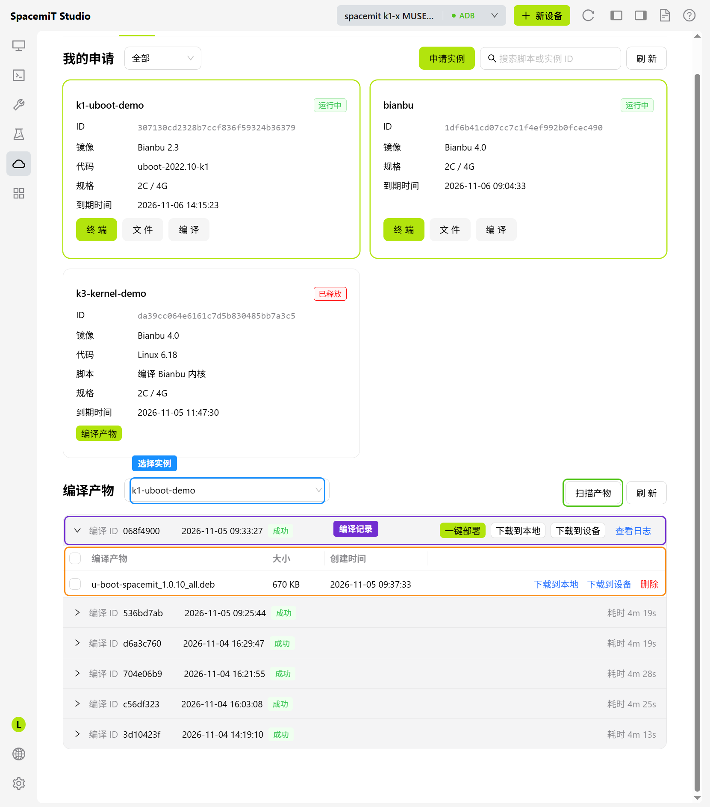

- **编译记录**：可折叠的记录行，左侧显示编译 ID、开始时间与状态；右侧提供**一键部署**、**下载到本地**、**下载到设备**、**查看日志**四个操作。
- **编译产物**：展开后列出产物文件（如 `u-boot-spacemit_1.0.10_all.deb`）、大小与创建时间，每行也可单独下载。

若记录行内没有产物，点击**扫描产物**右侧的**刷新**重新读取。

此时产物仍存放在云端实例的工作区中。要把它送到本地的开发板，继续下一节的操作。

### 9. 产物下载与部署

平台提供两种方式，把上一步得到的产物从云端实例送到已连接的开发板：

- **下载到设备**：只把文件传输到开发板的指定目录，不执行安装。适合先自行检查文件，或稍后再安排安装。
- **一键部署**：把文件推送到开发板并立即执行安装命令，安装完成后重启生效。

两种方式都从**编译记录**行右侧的按钮发起，需要开发板已连接并处于运行中。

#### 下载到设备

点击**下载到设备**后，弹出下载对话框：

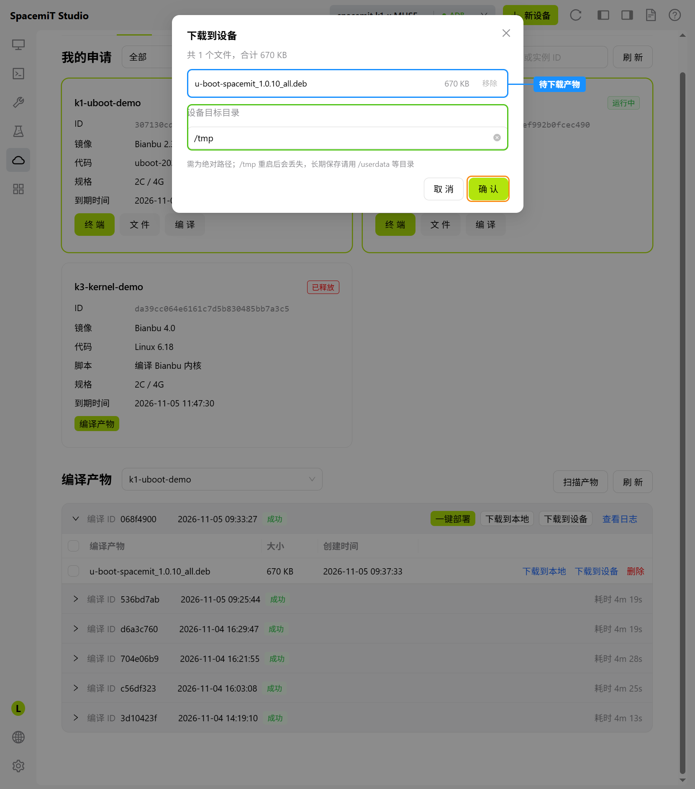

- **待下载产物**：列出即将下载的文件及大小。
- **设备目标目录**：指定产物在开发板上的存放路径。`/tmp` 重启后会丢失，长期保存建议使用 `/userdata`。

确认后，页面顶部显示下载结果：

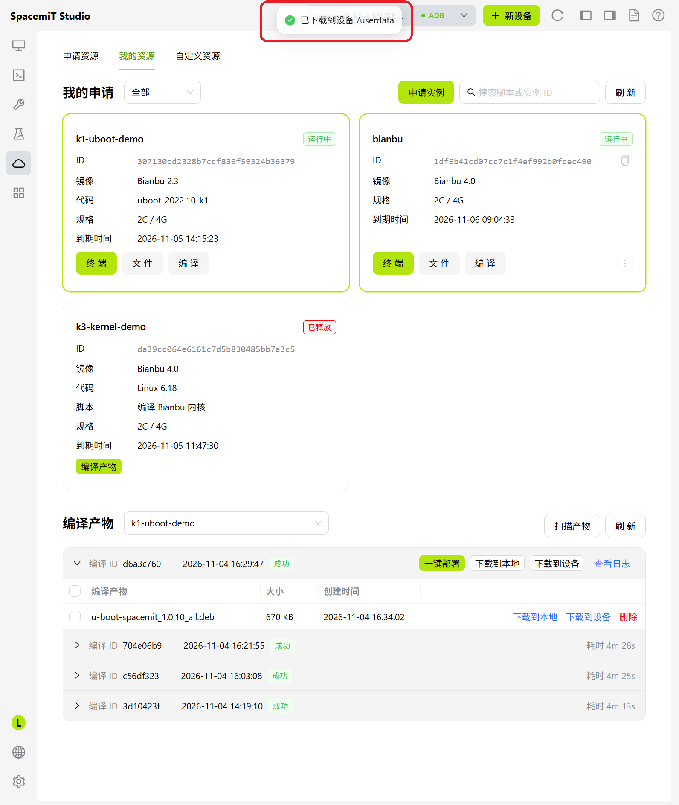

在开发板的文件管理器中，可以看到 `u-boot-spacemit_1.0.10_all.deb` 已出现在 `/userdata` 目录，验证产物已成功传输到设备：

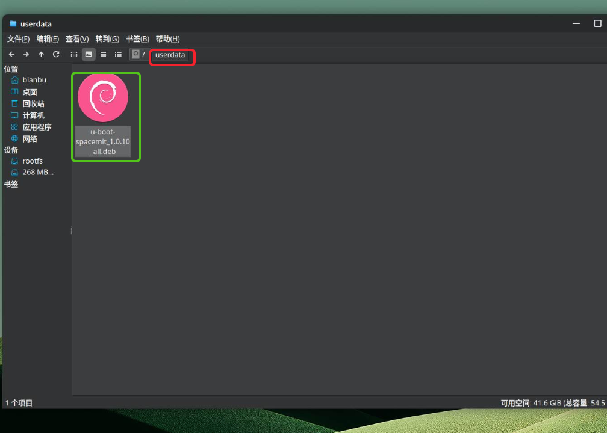

#### 一键部署

**下载到设备**只负责传输文件。若要让产物直接安装生效，点击**一键部署**：

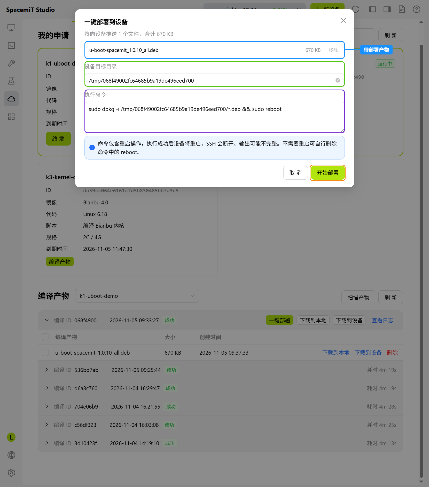

- **待部署产物**：列出即将推送的文件及大小。
- **设备目标目录**：平台自动按编译 ID 生成路径（如 `/tmp/068f49002fc64685b9a19de496eed700`）。
- **执行命令**：平台按产物类型自动生成，本次为 `sudo dpkg -i <目录>/*.deb && sudo reboot`。命令可编辑。

点击**开始部署**后，对话框显示部署进度与输出。完成后展示**部署完成**及完整执行日志：

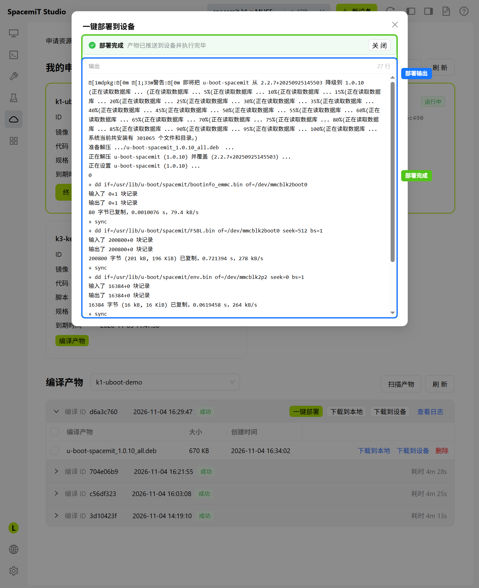

日志中可确认命令是否执行成功。具体的安装步骤由产物类型决定，以**执行命令**中实际执行的内容为准。

> 注：编译其他平台或其他类型的代码（如 K3 内核），流程相同，只需在第 1、2 步换成对应平台的镜像、代码仓库与构建脚本。选择原则见[申请资源](#申请资源)。

## 申请资源

**申请资源**标签页用于创建开发实例。页面分为左右两栏：左侧从上到下展示**镜像**、**代码仓库**、**构建脚本**三个选择区；右侧是**实例配置**面板。

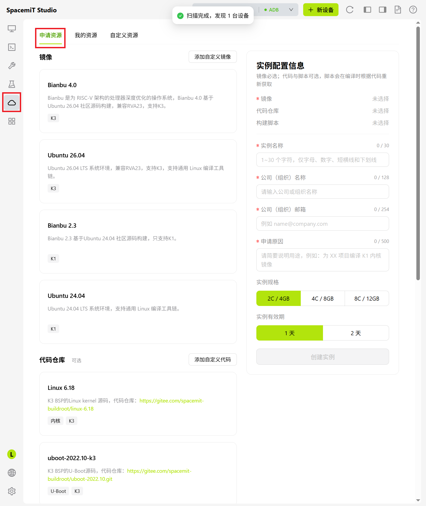

三个选择区的内容由平台维护，会随新平台和新版本持续更新，本文不逐一罗列，以页面实际展示为准。选择时把握一条原则：**镜像与代码仓库需属于同一平台**，K1 的镜像只能搭配 K1 的代码，K3 同理。任一卡片的**查看详情**可展开该版本的完整说明与仓库地址。

### 选择镜像

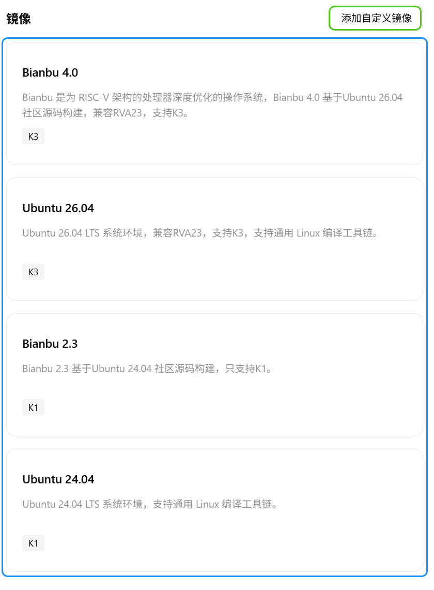

**镜像**为必选项，决定实例的系统环境。平台提供 Bianbu 与 Ubuntu 两个系列，各自覆盖 K1 与 K3：

- **Bianbu**：为 RISC-V 架构深度优化的发行版。
- **Ubuntu**：标准 Ubuntu 系统环境，带通用 Linux 编译工具链，适合验证上游代码。

点击卡片即可选中。如需使用自建的编译环境，点击右上角的**添加自定义镜像**，详见[我的镜像](#我的镜像)。

### 选择代码仓库（可选）

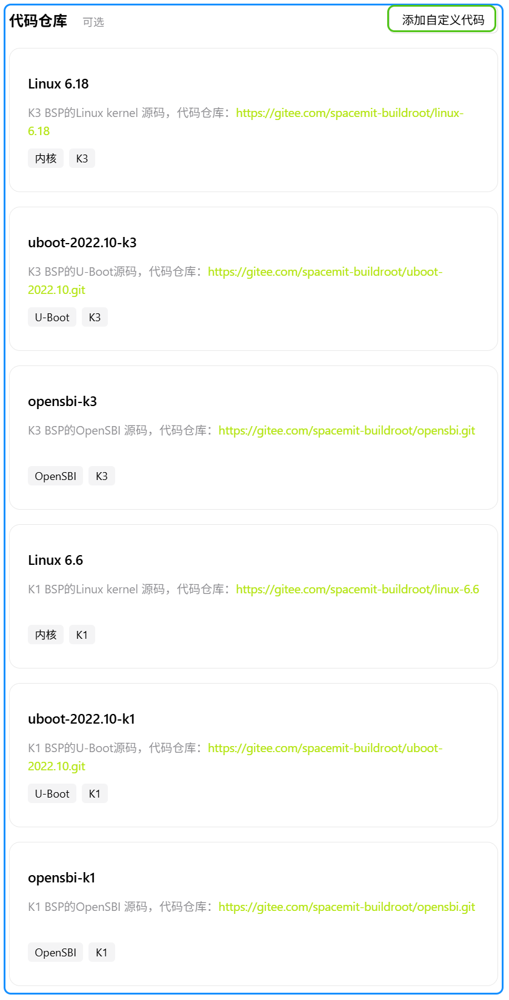

**代码仓库**为可选项。平台按类型（内核、U-Boot、OpenSBI）与平台（K1、K3）提供对应的 BSP 源码，卡片上标有类型与支持平台，展开**查看详情**可看到完整的仓库地址。

点击卡片即可选中。如需使用自建仓库，点击右上角的**添加自定义代码**，详见[我的代码](#我的代码)。

### 选择构建脚本（可选）

**构建脚本**为可选项。未选代码仓库时，该区域提示先选代码；选定代码后，平台按代码类型给出对应的预置脚本模板，以及一个**空白模板**用于从零编写。

点击卡片即可选中，脚本内容会在编译时根据所选代码重新获取。

也可点击**新建自定义脚本**创建脚本，详见[我的脚本](#我的脚本)。

### 填写实例配置信息

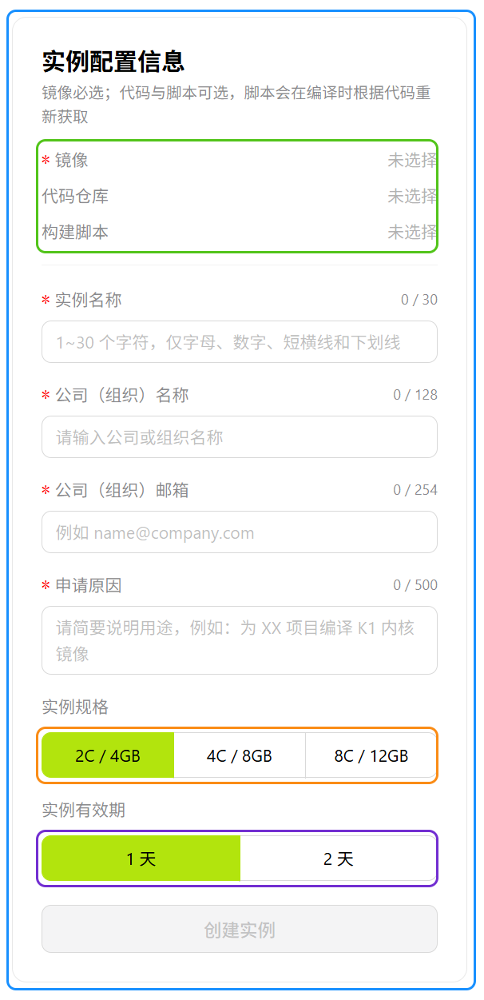

右侧配置面板顶部的**配置摘要**实时显示已选的镜像、代码仓库与构建脚本。下方的实例名称、公司（组织）名称、邮箱与申请原因均为必填，其中实例名称仅支持字母、数字、短横线和下划线。

### 选择规格与有效期

按编译任务的规模选择实例规格，并选择有效期。

配置完成后，点击面板底部的**创建实例**提交申请。页面会自动跳转至[我的资源](#我的资源)，新实例显示为**启动中**。

## 我的资源

**我的资源**标签页用于管理已申请的实例、进入工作台开发，并获取编译产物。页面上方是**我的申请**（实例列表），下方是**编译产物**区域。

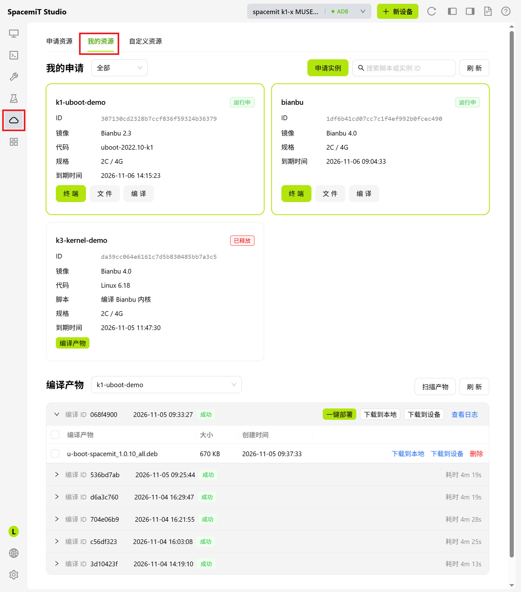

### 实例列表

列表顶部提供以下操作：

- **状态筛选**：默认显示**全部**，可切换为启动中、运行中、启动失败、已停止或已释放。
- **申请实例**：跳转到**申请资源**标签页创建新实例，见[申请资源](#申请资源)。
- **搜索**：按脚本或实例 ID 查找实例。
- **刷新**：重新拉取实例列表与状态。

每个实例以卡片展示名称、状态、ID、镜像、代码、脚本（如有）、规格与到期时间。卡片底部的操作随实例状态变化：

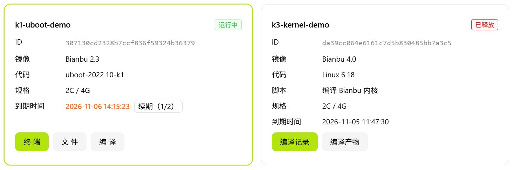

- **运行中**：提供**终端**、**文件**、**编译**三个按钮，分别用于打开终端、浏览文件和发起编译。
- **已释放**：实例资源已回收。卡片提供**编译记录**和**编译产物**按钮，用于查看历史编译信息；鼠标悬停时右下角显示**删除**，用于移除这张卡片。

鼠标悬停在运行中的卡片上时，ID 右侧出现复制按钮，右下角出现**更多**按钮，用于修改名称、重启或提前释放实例：

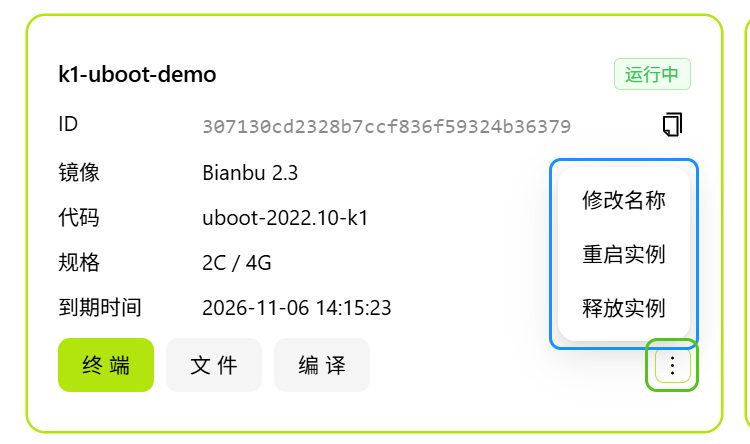

> 注意：实例到期或释放后，工作区被回收，编译记录仍可查看，但无法再扫描、下载或部署产物。需要保留的产物请在释放前**下载到本地**。

### 工作台

点击实例卡片或卡片上的**终端**、**文件**按钮进入工作台：

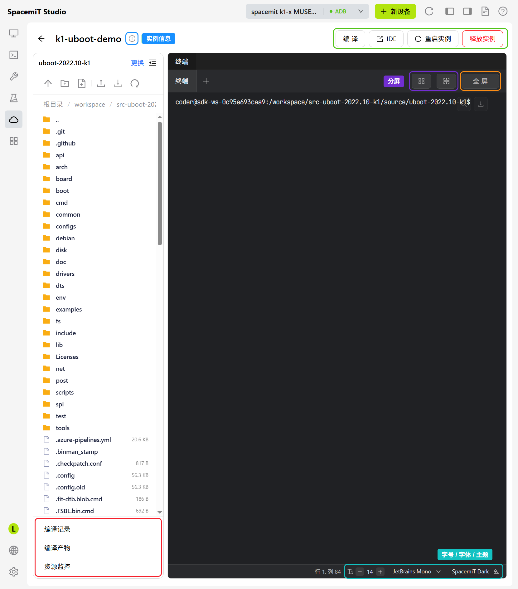

- **实例信息**：点击实例名称旁的图标，查看实例 ID、镜像、代码、规格与到期时间。其中还会显示资源上限（limit）与 PVC 磁盘容量；磁盘容量以首次申请时为准，之后变更规格不会扩容。
- **顶部操作**：**编译**打开编译对话框（见[第 6 步](#6-发起编译)）；**IDE** 打开 Web IDE；**重启实例**、**释放实例**与卡片**更多**菜单中的同名操作相同。
- **文件管理**：左侧面板展示工作区目录树，工具栏支持返回上级、新建文件夹、新建文件、上传、下载与刷新。
- **终端**：点击 **+** 新建终端标签；支持**分屏**与**全屏**，底部状态栏可调整**字号**、**字体**与**配色主题**。
- **左下导航**：**编译记录**、**编译产物**、**资源监控**，点击后在右侧以新标签页打开。

#### 更换代码与脚本

鼠标悬停在文件面板顶部的代码名称上，右侧出现**更换**按钮。点击后弹出**选择代码与脚本**对话框，可为当前实例重新绑定代码仓库与构建脚本：

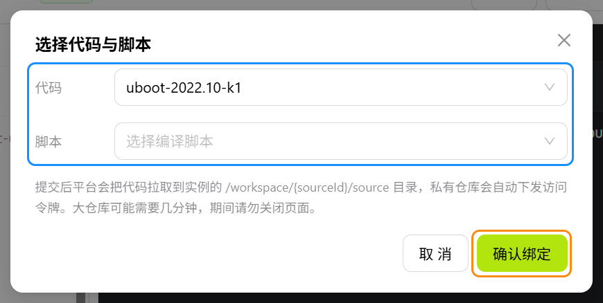

#### 资源监控

**资源监控**实时显示实例的 CPU、内存与磁盘用量，可通过右上角下拉框切换统计的时间范围：

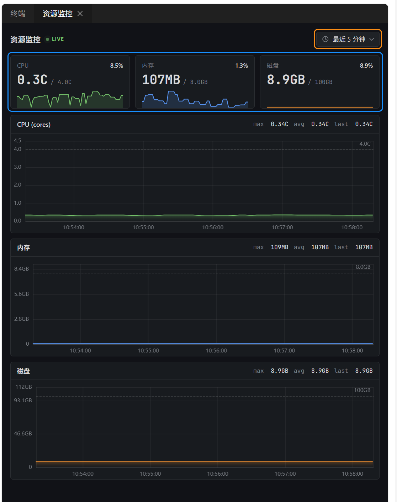

顶部三张卡片显示当前用量与上限，下方曲线图显示所选时间范围内的变化趋势，以及最大值（max）、平均值（avg）与最新值（last）。编译变慢时，可在这里确认是否已触及 CPU 或内存上限，再决定是否申请更高规格的实例（见[选择规格与有效期](#选择规格与有效期)）。

### 编译产物

页面下方的**编译产物**区域按实例汇总编译记录，操作步骤见[快速上手第 8 步](#8-获取编译产物)。

每条记录提供以下操作（一键部署与下载到设备的完整流程见[第 9 步](#9-产物下载与部署)）：

- **一键部署**：推送到开发板并执行安装命令。
- **下载到设备**：只传输到开发板的指定目录。
- **下载到本地**：下载到本机。
- **查看日志**：查看本次编译的完整日志。

## 自定义资源

**自定义资源**标签页包含**我的镜像**、**我的代码**、**我的脚本**三个子标签页，用于沉淀可复用的开发资源。创建的内容仅自己可见，[申请资源](#申请资源)时可直接选用。

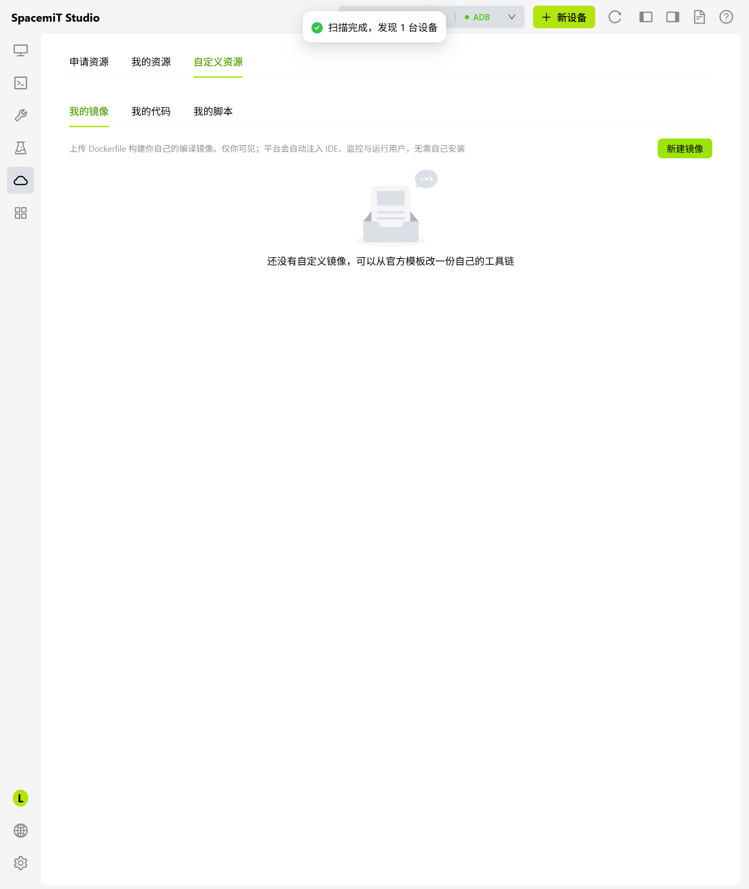

三类资源各自独立，可以组合使用：镜像决定编译环境，代码仓库提供源码，脚本定义编译步骤。

### 我的镜像

上传 Dockerfile 构建自己的编译镜像。平台在构建时自动注入 IDE、监控组件与运行用户，无需自己安装。

基础镜像必须支持 `riscv64` 并使用 glibc（不支持 Alpine），且需安装 `bash`、`coreutils`、GNU `grep`、`procps` 和 `findutils`。构建时不支持通过 `COPY` 引入本地文件；`ENTRYPOINT`、`CMD`、`USER` 和 `EXPOSE` 会被平台覆盖。其他要求和限制以创建对话框中的**构建须知**为准。

点击**新建镜像**打开创建对话框：

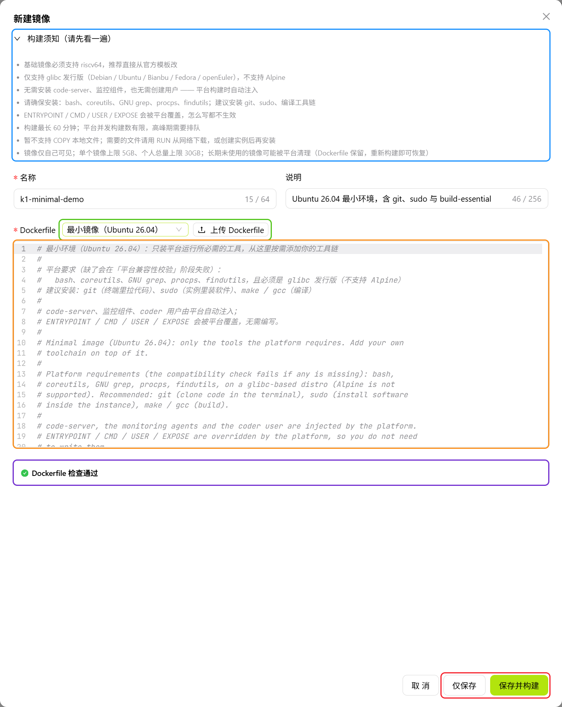

- **构建须知**：列出基础镜像要求、构建时长与容量限制，创建前务必先看一遍。
- **名称**与**说明**：名称必填，说明用于日后分辨。
- **Dockerfile**：可从预置模板下拉框选择起点，也可点击**上传 Dockerfile**导入已有文件。模板覆盖最小镜像与各平台的内核编译镜像。

编辑时平台实时校验 Dockerfile，下方显示检查结果。通过后点击**保存并构建**提交构建，或点击**仅保存**先存下来稍后再构建。

构建完成后列表显示**可用**，并标注构建次数、镜像大小与更新时间。**重新构建**、**编辑**、**删除**分别用于重建、修改配置和移除镜像。

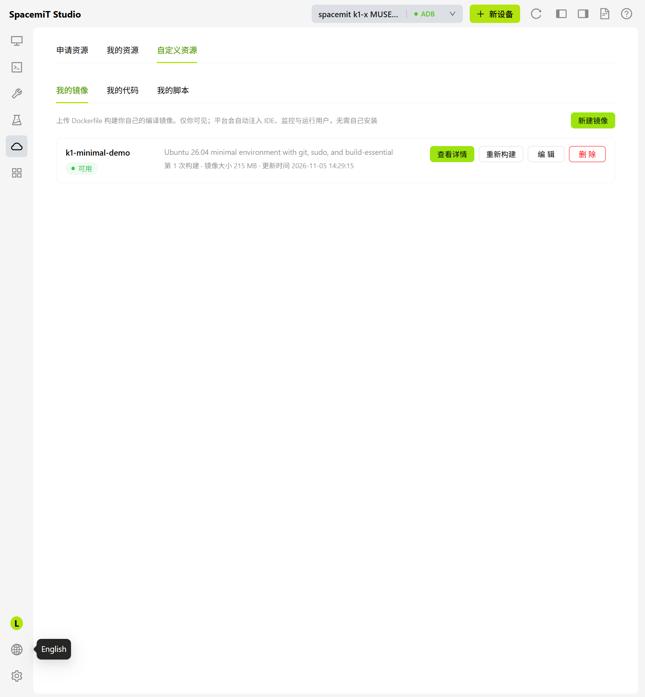

点击**查看详情**进入详情页，可查看构建进度（排队、构建 Dockerfile、注入平台运行时、平台兼容性校验）与构建日志，也可直接点击**申请实例**用该镜像创建实例。

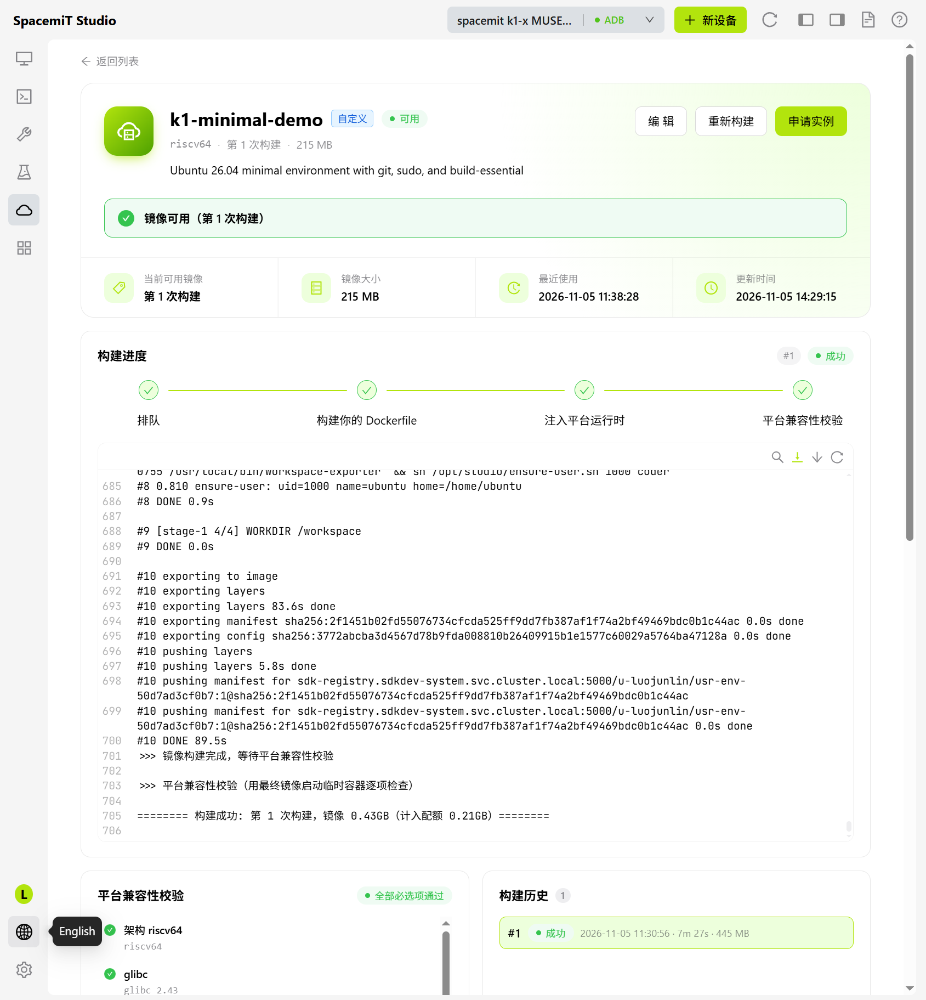

### 我的代码

关联自己的 Git 仓库，即可在云上编译，代码会自动克隆到工作区。

点击**添加代码**打开对话框：

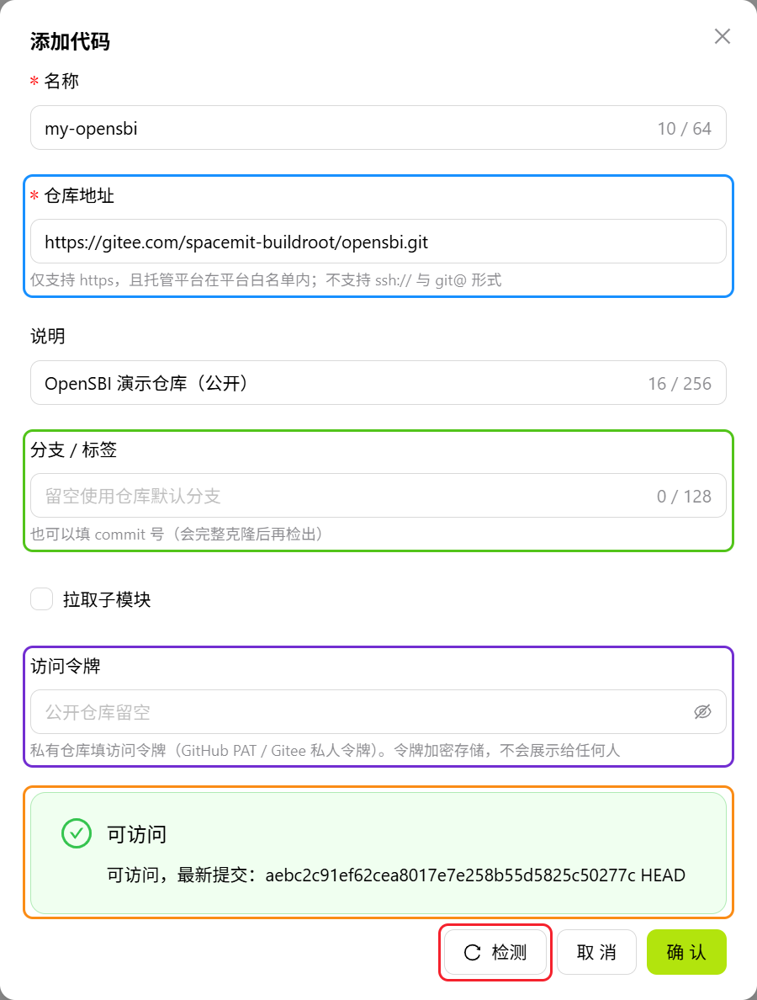

- **名称**：必填，用于在申请实例时识别这份代码。
- **仓库地址**：要关联的 Git 仓库地址。目前仅支持平台白名单内的 HTTPS 仓库（Gitee / GitHub），不支持 `ssh://` 或 `git@` 地址。
- **说明**：选填。
- **分支 / 标签**：指定分支、标签或 commit 号；留空使用仓库默认分支。填写 commit 号时会完整克隆后再检出。
- **拉取子模块**：仓库含子模块时勾选。
- **访问令牌**：仅私有仓库需要填写。

填写仓库地址后点击**检测**，平台校验连通性并显示最新提交号。检测通过后点击**确认**保存。

列表中的代码卡片显示**可访问**状态、仓库地址与代码大小；尚未拉取过的代码显示「尚未克隆」。卡片提供**查看详情**、**重新检测**、**编辑**和**删除**。

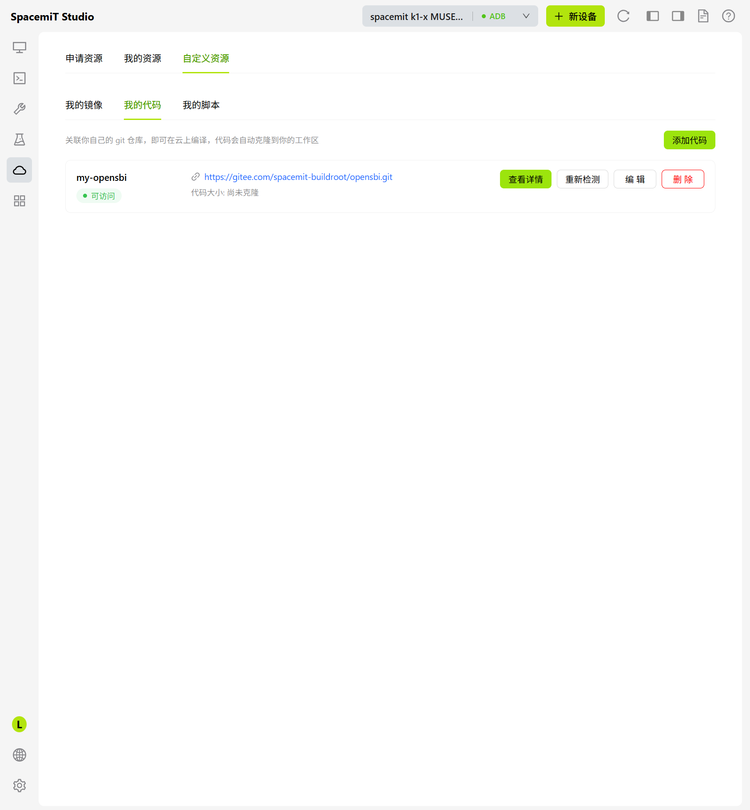

> 注意：代码需通过连通性检测后才能用于申请实例。

### 我的脚本

把常用的编译流程保存成脚本，在任意工作区一键复用。

点击说明文字旁的**编写说明**可查看脚本编写规范：

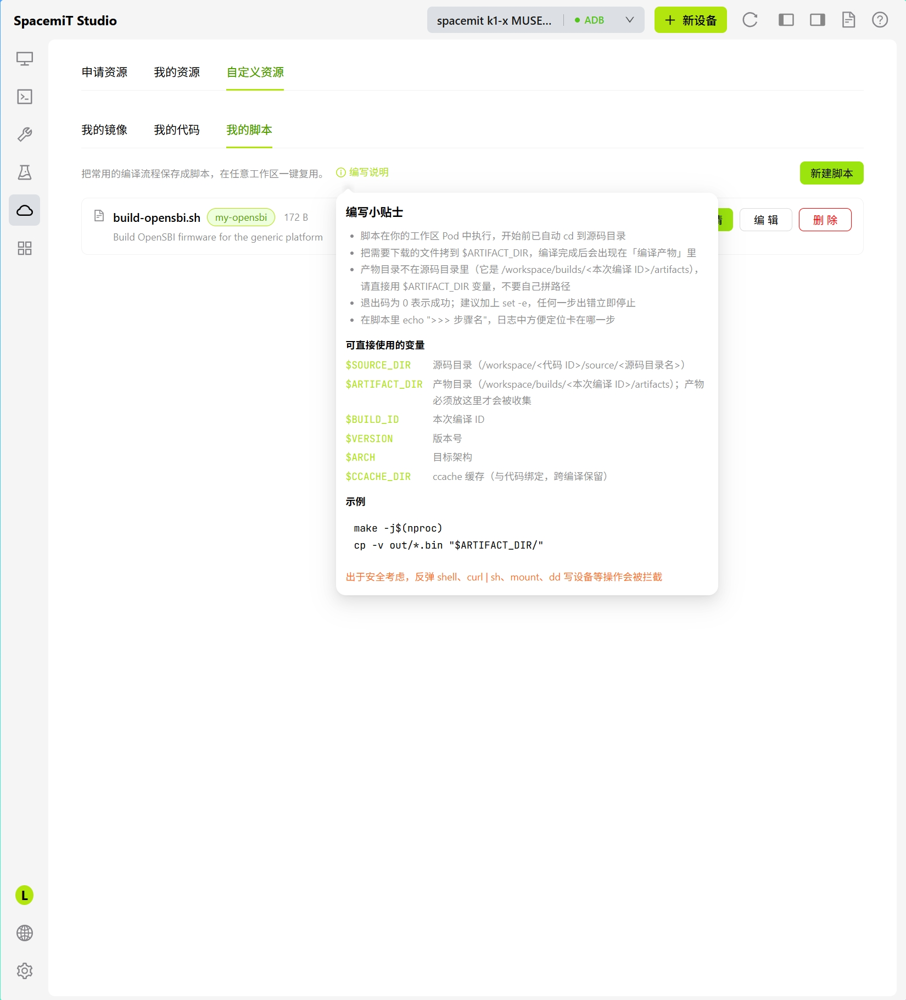

其中最关键的一条：产物必须拷贝到 `$ARTIFACT_DIR`，编译完成后才会出现在**编译产物**里。

点击**新建脚本**打开编辑器：

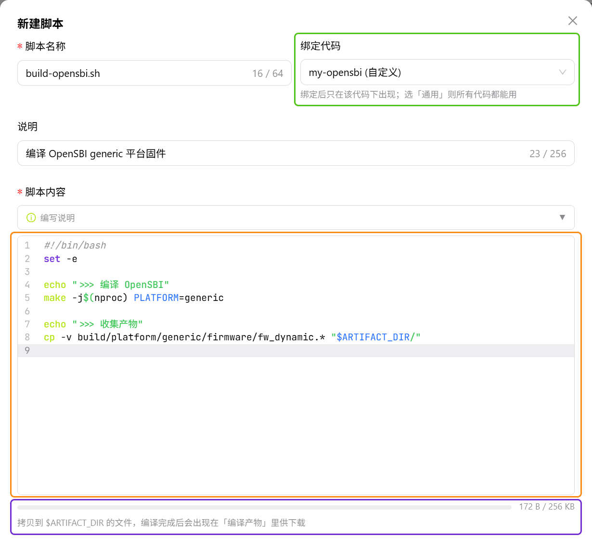

- **脚本名称**：必填，如 `build-opensbi.sh`。
- **绑定代码**：选择脚本适用的代码仓库，或选**通用（任意代码）**。
- **说明**：选填。
- **脚本内容**：必填，编辑器支持语法高亮。编辑器上方的**编写说明**可展开查看编写规范。
- **体积与产物提示**：编辑器下方显示脚本体积，并提示产物的存放位置。

填写完成后点击**确定**保存。保存后卡片显示脚本名、绑定的代码、体积与说明，提供**查看详情**、**编辑**和**删除**。

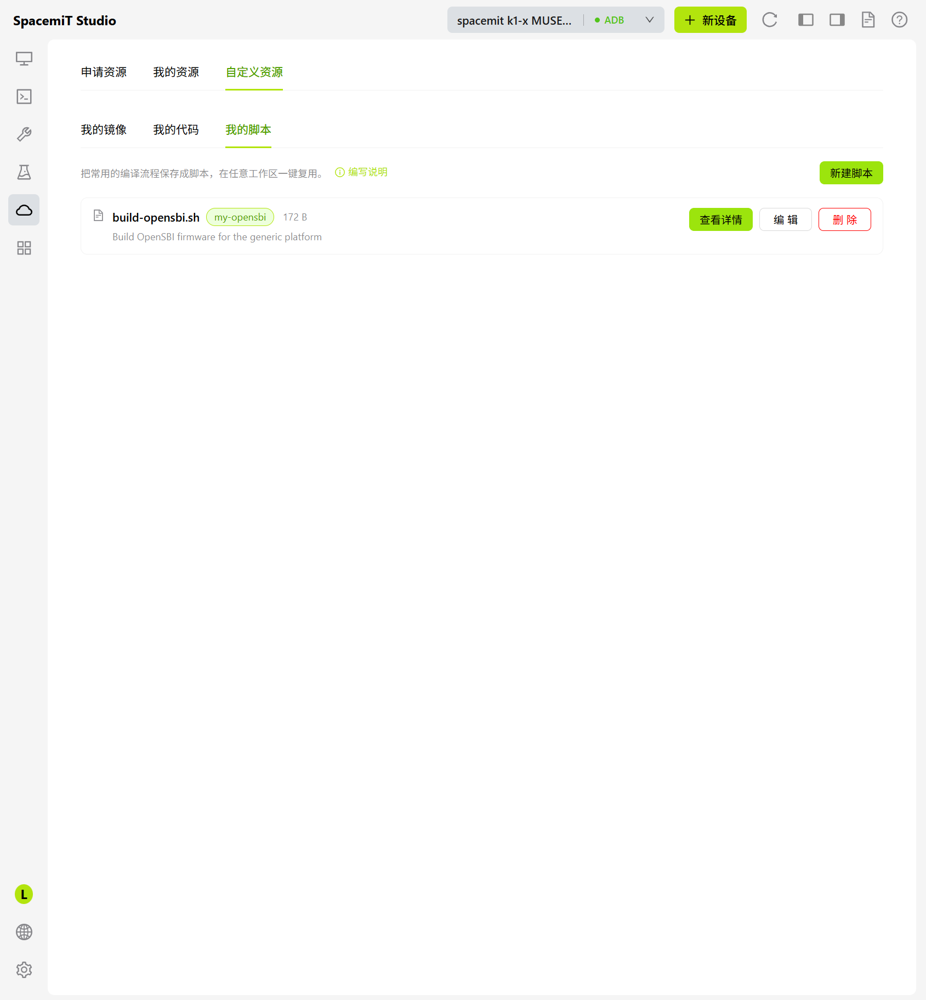
